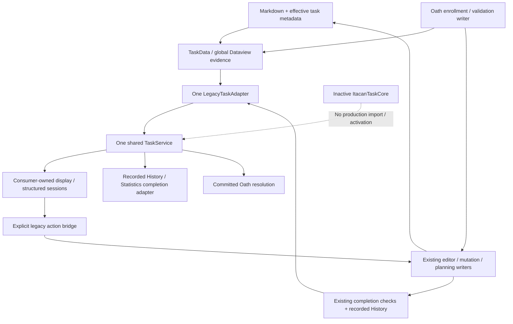

# Phase 2B consolidated read-architecture audit

2026-10-17 · Europe/Stockholm · **Audit only — STOP FOR REVIEW**

## Executive findings and verdict

**Ready for a narrowly scoped native-writing preparation phase.** This means inactive contract preparation can begin after review. **It does not mean ready to switch task authority.** No verified Critical active-runtime defect was established in the inspected paths or executed isolated checks. Several verified High limitations block their dependent future phases: native consumer contracts/readiness, durable mutation intent, migration fidelity and completion lineage, production storage/owner lifecycle, and complete shared-Project transport.

**Safety exception requiring review:** final inspection detected concurrent changes to plugin `data.json` and app-managed `workspace.json`. Further test execution stopped. Code, installed bundle, Markdown and shared Project state remain baseline-identical. The plugin data write timestamp is after all audit test/probe runs finished, consistent with concurrent application activity, but its originating process and exact field delta were not established. Neither file was restored. This audit cannot certify that all protected user data stayed byte-identical; see safety evidence/U3 before authorizing later work.

All intended Phase 2B display/recorded/commitment consumers are connected to the shared facade. Remaining direct TaskData enumeration outside its adapter belongs to Oath's intentional validation/enrollment writer boundary. Other direct source reads are writer preflight, post-write reconciliation, shared metadata selection, or independent historical/note providers. No active overlooked task display consumer was identified. This is a static call-graph conclusion supported by current tests, not a claim about arbitrary external scripts.

The single facade has sound explicit backend selection, typed failures, consumer-owned sessions, detached values and subscription ownership. It is **not yet a drop-in native consumer contract**: structured rows, committed Oath hydration, recorded History, legacy conversion/reveal and Dataview readiness still require legacy data. Representative native adapter tests establish only their exercised neutral subset.

Four deliverables comprise the audit:

- This report, including policies, findings, writers and verification.
- [Complete read inventory](task-read-architecture-inventory.md).
- [Field/contract compatibility matrix](task-read-architecture-compatibility.md).
- [Detailed native-writing handoff and exact next phase](../services/TASK-SERVICE-NATIVE-WRITING-HANDOFF.md).

No recommendation in these documents authorizes implementation.

## Evidence baseline and review scope

Fresh baseline: **1,102 existing files, 329 initial Git-status entries**. Production source, installed assets, tracked/untracked work, Markdown outside backup/generated exclusions, local plugin data, shared state and app-managed workspace state were hashed before verification. The only workspace additions allowed by this audit are the four documents above and evidence under:

`System/Backups/itacan-read-architecture-audit-20261017-34c14edd/`

The complete 1,690-line request was accessible and reviewed. Source inspection covers the canonical plugin entry, facade/contract/adapter and helper modules, TaskData, editor/mutations/planning/Inbox/data-store/shared-project paths, task/date/history/statistics/Oath domain boundaries, all migrated consumer entry points, and **all native-core source modules and declarations**. Native tests/support/fault and verification documents were reviewed for their exercised guarantees; not every assertion in every historical browser fixture was re-inspected. The inventory records indirect paths and negative-search scope.

Fresh **read-only staged build: 167 modules**, kept under OS Temp, exactly matches installed `main.js`:

`318CD234980489C514E1C1085DF2D95FEBFEF64284D0293BC566493B4B28DB20`

All **30** latest `finalReviewedInputs` still hash-match. Nine production modules physically retained in that phase's final-source-build staging also match. Canonical Home/Project dashboards and shared state match the latest manifest; local plugin data subsequently drifted as disclosed above. Bundle equality establishes source/build correspondence, not which bundle the running Obsidian process has loaded.

Evidence files include `baseline.json`, `build-correspondence.json`, `historical-correspondence.json`, per-suite logs, `audit-probes.cjs/json`, final safety results and a SHA-256 archive inventory. Final byte/status results are recorded in `safety-final.json`; application-managed changes are separated from authorized edits.

## Current authority and call graph

`plugin.js:12731,12745,12750,12776` constructs Oath before the facade, then starts it only after the facade is available at layout-ready. `task-service-host.js:5` injects exactly one LegacyTaskAdapter and registers facade closure at plugin cleanup. There is no auto-discovery, per-consumer backend choice, native fallback, hidden store initialization or dual write.

The facade forwards operations as promises; capabilities explicitly deny durable legacy revisions, atomic task+History and persistent idempotency. Legacy mutations still use existing writers. Accepted facade writes drain during close. Direct editor/plugin writers use their own existing queue/lifetime; this is not a new plugin-wide durable shutdown broker.

## Complete inventory and intentional boundaries

The [inventory appendix](task-read-architecture-inventory.md) is the complete table of migrated consumers and material retained reads, classified A–F as requested. It includes Quick Add, Inbox, Add/Edit, inline/Step actions, clear, menus, recurrence, saved targets, Phase assignment, reports, presets/Last File and background invalidation.

Important classifications:

- **A:** fresh editor/inline/clear/Phase/Oath source checks and creation retry scans are writer dependencies; migrating display did not authorize replacing them.
- **B:** notes, reports, activity, Oath History, configuration/presets and historical snapshots remain independently authoritative.
- **C:** DTO projection, legacy handles/reveal, recorded primitive history and bounded pending-note reconciliation remain explicit compatibility boundaries.
- **E:** independent cold consumer scans and strict bulk compatibility queries have measurable cost; they are not extra task authorities.
- **D/F:** none identified among active inspected production paths. Dormant DESKTOP conflict-copy scripts contain old reads but have no canonical loader reference in the inspected graph; do not delete them during this audit.

## Consumer policy matrix

| Consumer | Ownership / workspace eligibility | Physical scope / explicit Project references / mounts | Completed parents / Steps | Identity and validation |
|---|---|---|---|---|
| Search | Physical registered Project/Resource, including inactive Projects | Global or chosen owner; no Home page-reference reassignment, no mount expansion | Completed included; Steps stay with parent, no independent result family | ID-less/copies may display; indexed evidence; strong reveal preflight |
| Daily Brief | Eligible Active Projects and available Resources, with Oath restrictions | valid workspace locations; no ownership transfer through mounts | Recommendations use open/current tasks; nested Step/progress evidence; saved target revalidated | Source-checked selected rows; invalid/ambiguous excluded; saved target source checked |
| Schedule | Project context; current Project workspace policy rather than Oath-setup Active-only rule | validLocation(root), excludes hidden/System/Templates; no Resource Schedule or mounted expansion | Existing scheduling groups determine completed visibility; hierarchical Steps retained | Indexed structured read; fresh action/source checks |
| Project Tasks | Current physical Project; not forcibly Active-only like setup | Root-inclusive panel policy, broader than Schedule; explicit page reference does not transfer ownership | Completed available to existing groups/clear; nested Steps | ID-less/copies display where safe; action ambiguity blocked; indexed |
| Resource Tasks | Physical registered Resource | Same root-inclusive panel policy, no host Project association | Same Task/Step semantics as Project panel | Same indexed/action checks |
| Roadmap Phase picker | Owning Project only; draft planning revision | Project valid locations; missing assigned IDs retained as draft evidence; no mounts | Existing parent candidates/assignments, including completed assigned evidence; Steps not independent Phase tasks | Indexed discovery, global identity diagnostics; fresh delta-only Phase save |
| Home | Resource-first presentation; otherwise explicit Project reference/physical Project; visible Project cohort Active | All eligible task locations under original Home rules; page reference can affect presentation only; mounts do not change primary owner | Existing active/future/completed groups; parent + nested Steps | Indexed plus detached Home evidence; action-time owner/source preflight |
| Oath candidates | Available Active Project or registered Resource | Selected physical root/dashboard; mounted Resource navigation never makes it a Project candidate | Open parents; active and future; nested Steps shown, not independently committed | Indexed parent policy, ID-less selectable; global copied-parent exclusions; copied Step diagnostics don't impose generic edit policy |
| Oath committed | Persisted workspace, resolves without setup's Active-only filter | Current unique parent ID and fresh source; physical committed owner; saved path/title are historical | Completed parents hydrate; fresh Step progress | Global identity + selected-note source; unavailable/ambiguous explicit; bounded enrollment bridge |
| Recorded History | Recorded owner/target kind, not current physical task | Recorded path evidence only; moved/deleted source does not erase event; no mount expansion | Stored task/Step events and original snapshots | No current task lookup; recorded primitives and diagnostics; source navigation checks only recorded file |
| Statistics | Historical stable-ID cohorts incl inactive/deleted and unassigned | Original recorded Project fallback; no reassignment from current paths | Recorded task/Step counts, not live checkbox totals | Recorded completion input; truthy-ID dedup before time filtering; no task scan |

Differences are intentional, not eligibility drift. In particular, Oath setup and committed hydration answer different questions; panel and Schedule location scopes differ; Home presentation and Search physical attribution differ; History is not reconstructed from current state.

### Resources and shared Projects

`lib/config.js:12` registers all four Resources with persisted IDs: Knowledge `study`, Research `literature`, Explorations `references`, Inspiration `inspiration`. `plugin.js:4412,4440` exposes/locates them Resource-first. The canonical Project dashboard handles Resource Tasks/History, and Oath accepts available Resource workspaces. Legacy root aliases remain supported. Native partitions must retain these IDs or explicit registry aliases; labels are not identities.

`lib/services/shared-projects.js:8,20,54` allowlists **Projects/Itacan** and **Projects/Obsidian Hub**, selects Markdown hidden IDs for shared taskMetadata, and excludes private Resource mounts and unrelated local state. `System/Hub-shared-projects.json` contains both registered Projects. Completion History, Oath/device state and other private evidence are not indiscriminately added to that shared payload.

This boundary is source-derived today; removing Markdown task markers without replacing shared membership would lose metadata sharing. Native shared export must be owner/partition-based with both Projects supported from cutover. The full local native generation contains private tasks/Resources/history/receipts and must never be Git-exported. A mounted Resource stays Resource-owned/private; do not copy its tasks into the Project or revive linkedProjectId.

## Identity and source-validation analysis

The durable legacy identity is an optional Hub hidden ID; native identity is a required UUID. A legacy handle adds path/line/expected normalized first title. ID-less locators, UI keys, Step ordinals, recorded event IDs, persisted Oath references and repository generation IDs are different identities with different lifetimes.

`task-data.js:86` analyzes globally before scoping. Copied parent/Step identities, collisions across Projects/Resources and copies outside the selected root can therefore affect safety. Display may retain ambiguous rows with disabled actions; generic strict actions reject. Oath setup retains its parent-commitment policy rather than adopting every generic Step/edit restriction. Historical rows survive current copies unchanged.

ID-less tasks remain visible. Generic actions require a current unique temporary locator; identical titles in one note cannot safely become durable identities, and moves/title/source changes require refresh. IDs are allocated only by authorized writer/enrollment/create operations, never ordinary reads. Oath's existing source-existing-ID enrollment behavior remains legitimate.

| Operation | Indexed evidence | Fresh source | Uniqueness / owner | Writes permitted |
|---|---|---|---|---|
| Search/Home/panel/Schedule display | Yes; diagnostics/policy-specific inclusion | No ordinary source reads | Global index identity diagnostics; physical/presentation roles separate | No |
| Phase candidate display | Yes; plus optional global assignment lookup | No | Global IDs; owning Project | No |
| Daily Brief recommendation | Initial global index then selected rows | Once per selected note | Parent/Step IDs, source locator and current owner | No |
| Oath candidate display | Yes, parent-specific eligibility | No | Global parent identity conflict, physical selected workspace | No |
| Reveal / saved target / edit open | Current index + handle | Yes | ID/title/Step checks; caller rechecks navigation/eligibility | No |
| Task/Step mutation | Action bridge then source writer | vault.process + snapshot/locator validation | Current physical owner, metadata/Phase and Step parent checks | Existing writer only |
| Phase/Oath enrollment | Current eligibility then source | Yes, within writer queue/transaction | Current owner + expected metadata/identity rules | Existing authorized identity/metadata/commitment writes |
| History/Statistics read | None required | None | Recorded attribution, event IDs independent of live identities | No |
| History source navigation | Recorded path only | File existence/navigation, not live task resolution | Never silently reidentify moved task | No |
| Native command (inactive) | None | Repository generation/revision, external ref resolvers | Global UUIDs + task/owner/partition/Step invariants | Disposable tests only |

Legacy source freshness is **not a transactional vault-wide snapshot**. Adapter preflight can await before the queued source writer. Source transforms revalidate locators/exact snapshots and compensate only bytes they wrote; independent external files/metadata can change. Global uniqueness is based on current index plus selected source checks, not a fresh scan of every note per action. Plugin queues do not serialize another window/device, OneDrive or arbitrary editors. `HubDataStore.assertDiskRevisionUnchanged` detects changed disk signatures; local/shared saves compensate rather than provide distributed atomicity.

These are declared legacy limitations, not newly introduced regressions. Native integration must strengthen the command boundary rather than inherit index evidence as write authority.

## Parent/Step, metadata and date compatibility

The [field matrix](task-read-architecture-compatibility.md) records each representation and unresolved mapping. Native core supports flat records with nested Step parent IDs/order, one primary owner, optional folder/note context, title/description, Necessity, local endpoints, Phase references, completion timestamps and retained history/tombstones. Source DTOs preserve ancestry through intervening non-task lists.

Verified gaps before migration/writer cutover:

1. Legacy IDs such as `legacy-parent` are valid; native canonical UUID validation rejects them. Design stable aliases for parents, Steps, History and Oath, including global copies and ID-less sources.
2. Legacy same-date start 18:00 / due 09:00 passes metadata validation; native create rejects it. Decide compatibility without rewriting dates or silently converting date-only endpoints into midnight.
3. Output Step DTOs have ancestry/order, but StepDraft does not expose native ancestry/order editing. Existing legacy snapshots retain structure privately; a native create/save implementation needs an explicit tree contract.
4. Indexed continuations/full Markdown block content are not synonymous with description. Native records have no dedicated lossless source block field. Migration needs preserved provenance/content evidence and reviewed handling of Tasks syntax.
5. Native core has no recurrence engine. The existing toggle can delegate to the Tasks plugin, which can create/rewrite occurrences. Keeping a literal recurrence string does not preserve that behavior.

Local dates/times remain local wall-clock values; completion timestamps are numeric instants. Explicit "00:00" differs from time:null. Existing Schedule/Statistics use local calendar/DST operations, not fixed 24-hour bucket arithmetic. Native schema has no timezone/recurrence policy; cross-device timezone behavior is not established by date-validation tests. Unknown imported task timestamps must be explicit null to avoid defaulting to migration time.

Migration must map **the source note's parent folder to folder context**, preserving the note as provenance, not forcing a permanent note association. Owner-root/unassigned context is representable as location:null. Stable location registry, rename/delete/move lifecycle and same-owner resolvers are still host work; no location UI is authorized.

## Recorded History and Statistics

`task-history-legacy-read.js:10` detaches safe raw primitives, preserves duplicate event occurrences/order and emits per-field/row diagnostics. `task-history-read.js:51` caches recorded queries independently of TaskData, gives duplicate rows temporary occurrence keys and navigates recorded existing files without live task reidentification. Deletion/move/copy of current tasks does not rewrite original recorded owner, title or timestamp.

Legacy completion/check/history methods at `plugin.js:5670,5688,5710` and `domain/task-progress.js` distinguish parent/Step events, reopening/recompletion and archival. Clear retains recorded evidence, removes source blocks/checks, and can tidy metadata; it is not history deletion. Existing save may succeed in Markdown while History persistence fails with a notice; facade reports that guarantee honestly.

Statistics snapshots notes/workspaces/activity/reports/Oath histories separately from its completion query. `domain/statistics.js:54,64` deduplicates only truthy recorded IDs **before** validating timestamps, distinguishes task/Step events, and attributes deleted/inactive cohorts by recorded stable IDs; legacy project-name fallback supplies a display name, not identity matching. Five ranges remain; `ui/statistics.js:32` explicitly defaults to **All time**. The domain aggregator's optional 3m default is overridden by this caller, so it is not a modal regression. Range/workspace changes aggregate the cached snapshot; reopening acquires a new one.

Native completion operations atomically save event + current binding + receipt. Reopening marks old events uncounted, retaining evidence. Native queryHistory defaults to **all retained events**, so a future Statistics adapter must choose the counted/event semantics deliberately. Native completed create generates a fresh event; no public command imports an existing current completion binding. Historical-only `history.record` requires no live task/Step identity. Importing legacy events separately plus creating completed tasks would need explicit lineage handling to avoid duplicates. That is a migration API prerequisite, not a current production double-counting finding.

## Oath candidates versus committed work

Candidates use facade indexed physical-parent discovery for available Active Projects/Resources, preserving active/future grouping, selection keys, nested Steps and global copied-parent exclusions. Source/identity enrollment remains in `oath.js` writer methods. Candidate DTOs/temporary selection keys are not persisted as commitments.

Committed hydration uses saved `{id,path,text}` only as durable parent ID plus historical snapshot, resolves the unique current parent, fresh source/Step progress and physical committed owner, and can hydrate completed parents or an inactive Project's existing commitment. Missing/copied/wrong-owner evidence becomes explicit unavailable/ambiguous state. Fresh current title/path may differ from saved title/path without changing the persisted commitment.

Both enrollment-created awaitingIndex histories are valid:

- A new ID was allocated during enrollment.
- An ID already existed in source while that same enrollment saw an ID-less stale index.

The existing operation-local map can bridge both only under current locator/text/source/owner/identity checks. Arbitrary missing or recovered commitments must not acquire a bridge. **The rejected fresh-allocation-only restriction remains unapplied and is not a native-authority prerequisite.**

Oath owns one facade subscription after start/first hydration, not another TaskData watcher. Generation/commitment/workspace signatures discard obsolete reads; ordinary clock ticks reuse hydrated work. Exactly-once fulfillment and Standard/Strict lifecycle remain with existing Oath authority. Current 119 committed focused checks and safe Strict tests pass; no real Oath or host restrictions were activated.

Native Oath readiness still requires source-independent results and readiness (current `ready()` requires Dataview), alias-compatible persisted references, completed/deleted task rules, receipt-aware outcomes and reviewed startup/recovery. Do not silently change commitments, Standard/Strict settings or all-device history as part of a task adapter swap.

## Async lifecycle and invalidation matrix

| Consumer | Cache / ownership | Stale publication and failures | Local writes / disposal |
|---|---|---|---|
| Search | Service task promise/generation; UI query tokens; own facade listener plus file/metadata listeners | Invalidations replace task cache; note workers/token checks; task error doesn't suppress unrelated categories | Reveal checks disposal; UI close doesn't close facade |
| Daily Brief | Service-owned TaskReadSession and availability/provider/day generation | Old day/scope/provider/disposed work discarded; failed query retryable, not successful empty context | Saved artifact immutable; current target validated separately |
| Schedule | Component-owned session + read generation, mode/workspace/rail guards | Closed/moved mode results discarded; previous rows retained on failure; draft render deferral | apply(edit) invalidates pending query and updates local rows; accepted writer remains its own operation |
| Task panels | Component controller/session + plugin cleanup registry | Generation, owner/mode and draft/focus guards; retryable status | Per-note pending accepted edit overlay until import acknowledgement/conflict; accepted cleanup writes outlive reader close |
| Phase editor | Modal draft/controller/session, planning revision | Selection/missing assignment baseline retained; stale candidates discarded; freezes save deltas | Only explicit deltas preflight/write; close releases reader, not shared service |
| Home | Component/controller/session + plugin registry | Generation, connection, interaction deferral; last valid rows/status on query error | Per-note accepted edits survive delayed index, metadata-aware acknowledgement; own close only |
| Recorded History | Component helper cached promise + history generation | Old/disposed results suppressed; invalid rows diagnosed; no task invalidation subscription | Explicit History notifications invalidate; pagination/filter uses snapshot |
| Statistics | Modal acquisition generation and one snapshot/aggregate cache | Close suppresses late result; unsafe relevant recorded evidence fails explicitly | No writer; reopen re-queries, range change does not |
| Oath candidates | Picker/setup component controller/session; selected-workspace signature | Switch/disposal invalidates; incomplete/error differs from empty; focus selection preserved | Enrollment draft is explicit legacy evidence; never persist read handles |
| Oath committed | Oath-owned subscription and refresh queue, sequence/revision/signatures | Changed commitment/workspace/root/close suppresses publication; retry pending reads | No writer moved; close/readClosed prevents late hydration/fulfillment publication |

One backend subscription lazily starts TaskData's five event references and a local-day timer; last subscriber removes them. TaskReadSession caches promises per options per consumer, loops on intervening invalidation, evicts failed promises and cancels publication on close. `plugin.js:12933` destroys Oath/TaskData; plugin registered facade cleanup owns closure. Consumer close does not close the facade.

Home/panels have explicit per-note lag overlays; Schedule instead applies edits locally and invalidates outstanding reads, with existing draft/mode guards. The combined real-host case of prolonged index lag plus an unrelated Schedule invalidation was not independently reproduced here; do not claim identical overlay guarantees across consumers. Native committed revisions should eventually eliminate Markdown-specific reconciliation only after equivalent delayed-write/close tests.

TaskData waits for completed Dataview imports, coalesces structural/import events per frame and checks day changes every 30 seconds without scanning every 30 seconds. Facade invalidation is global and carries no changed-path delta. Separate consumer caches can therefore all requery after unrelated task changes. Search also has justified non-task file/metadata invalidations; their overlap can trigger extra task work. This is a cost, not proof of stale publication or another backend.

## Consolidated performance evidence

**No timed benchmark was run during this audit.** A new deterministic counter probe uses real facade/TaskData fixtures: two identical consumer sessions plus a display query produce **3 cold global scans**, **0 additional scans for warm session reads**, **2 after invalidation**; one backend; event refs **5 → 0** when both sessions close. This substantiates independent cache costs without inventing live latency.

The following are **historical retained measurements**, reviewed from phase reports/archived logs. All run on synthetic in-memory Node fixtures, generally Node 24.21.0 / Europe/Stockholm; Search/Brief/panel/Phase use comparative runs, Home/History/Statistics/candidate use seven-run medians, committed uses controlled seven-sample GC-outside-timing medians. The current bundle matches the latest phase bundle, and reviewed source inputs match; these numbers were not rerun now and are not a whole-application latency measurement.

| Path / dataset | Retained original → facade measurement | Work/counters and interpretation |
|---|---|---|
| Search 5,000 parents | Cold 11.831 → 33.901 ms; three cached full searches 86.383 → 82.337 ms | One global index scan cold; zero task-source reads; cached projection avoids rescans. Canonical indexed text/ranking preserved. |
| Daily Brief 5,000 | Cold 22.696 → 73.180 ms; cached context mean 20.041 → 6.259 ms | One scan, **500 selected note reads** at ten tasks/note for new source validation; cache reuse adds none. Stronger evidence has an explicit cold cost. |
| Schedule 5,000 | Cold 12.774 → 33.459 ms; three view changes 18.088 → 17.874 ms | One scan, zero source reads; cache reuse for view/date changes. |
| Tasks panel 5,000 | Cold 19.375 → 51.971 ms; cached mean 14.119 → 0.056 ms | One scan, zero sources; two global identity passes vs one; three new workspaces still three scans. |
| Phase picker 5,000 | Cold 19.766 → 50.577 ms; cached 16.506 → 2.010 ms | One scan, zero sources; initially unlocated assignment IDs can add one global indexed check. Typing filters cached candidates. |
| Home 5,000 | Cold 6.496 → 26.881 ms; cached 6.456 → 3.370 ms | One scan/two global identity passes, zero ordinary source reads; per-note conflict overlay checks exceptional. |
| History 5,000 events | Initial 0.849 → 15.705 ms; refresh 0.933 → 13.630 ms | Detached raw evidence/diagnostics once per invalidation; zero task scans/sources; seven cached reads add no History query. |
| Statistics 5,000 events | Full snapshot 1.551 → 8.375 ms; recorded facade acquisition 5.577 ms | Zero task scans/sources; range aggregates cached. Historical isolated Chromium modal two-frame medians 31.3 → 32.7 ms are frame-paced, not live host cost. |
| Oath candidates 5,000 | Original discovery 7.562; current invalidated read/grouping 14.368 ms | One scan/two identity passes; zero sources; cached reads/requirements/countdown add no scans. |
| Oath committed ~5,000 / 50 refs | Cold 30.374 → 29.297 ms; repeated fresh 30.354 → 30.423 ms | One scan/batch; one TaskData identity + committed lookup pass; five unique source notes; ordinary countdown zero. 1/10/50 refs read 1/1/5 notes. |
| Inactive native core 10,000 | Historical one JSON update 1,046.076 ms; reopen 424.783 ms | Full validation/cloning/snapshot/flush + receipts; 12,310,356-byte generation. No host budget/long-history growth guarantee. |

Detailed tables at 100/1,000/5,000 remain in `context-search-verification.md:178`, `task-read-verification.md:196`, `task-panel-verification.md:156`, `phase-read-verification.md:176`, `home-read-verification.md:145`, `history-read-verification.md:184`, `statistics-read-verification.md:129`, `oath-candidate-verification.md:153`, `oath-committed-verification.md:134`, and native `ItacanTaskCore/VERIFICATION.md`.

Committed unforced samples had GC variation; controlled retained samples resolved that measurement uncertainty without cache advantage. Do not add these different workloads together as navigation latency or call cold projection overhead a correctness defect.

Priorities: (1) preserve batched global identity/source-by-note work and avoid strict per-task bulk APIs in display; (2) measure native full-generation/history/receipt growth before choosing host latency budgets; (3) consider shared immutable indexed identity context or selective invalidation only if real profiling justifies it. Existing strict queryOwned/queryVisible can perform N+1 scans; historical Search comparison documents 1,001 scans/1,000 source reads at 1,000 tasks. Migrated hot displays use batch projections instead. A large legacy cache redesign is low value/risky before native indexed authority replaces this path.

## Native-core readiness

Implemented and now reverified in **66 isolated memory/JSON tests**: globally unique task/Step identities; ancestry/order/owner/Phase/location validation; revisions; serialized commands; atomic candidate task/history/binding/receipt commit; canonical receipt replay/conflicting reuse rejection; logical partitions; explicit owner relocation; retained deleted evidence; detached indexed reads; subscriptions; pure sanitized shared packets.

Persistence uses a single explicitly selected existing local directory, exclusive writer lock for repository lifetime, immutable checksum generations and atomic CURRENT replacement. Verified recorded ancestry/RECOVERY may select an older committed generation; it never scans orphan generations as authority or silently resets empty. Pre-commit failures publish nothing; lost acknowledgement after commit remains receipt-replayable. Unknown locks/evidence are preserved; stale lock removal is never automatic. This is substantial inactive foundation.

Remaining production prerequisites:

- No plugin native adapter, storage host/broker, packaging dependency boundary or activation manifest. Portable core import avoids filesystem modules; production custom builder currently keeps core outside its plugin boundary.
- Partitions are declared at initial state; no public runtime owner/partition registration/deletion lifecycle. Workspace creation/rename/delete and aliases need deliberate integration.
- Location/Phase/queryScope are external resolvers, not a shipped persistent folder/note/mount registry.
- Existing multi-window host must route through one writer; exclusive local lock is not device-level collaboration or OneDrive conflict resolution.
- Whole-generation validation/cloning/history/receipt snapshots retain cost/growth. Receipt retention must preserve replay guarantees; do not just prune to meet timing.
- No migration command for existing completion bindings, full source fidelity/aliases, recurrence semantics or cross-store planning/Inbox/Oath transactions.
- Shared export/deserialize/head comparison are pure. No Git transport/import/merge, trust validation, remote head adoption, tombstone reconciliation or remote completion lineage is implemented.
- Directory fsync was unavailable in the original Windows fixture. Process interruption/injected errors are tested; physical power loss, live OneDrive behavior, ACL variants and multi-device Git are **unverified**.

Native core is sufficient to evaluate these gaps. No native live-vault verification or unsafe privacy experiment was needed; no authority/activation decision was taken.

## Current writer inventory and dependencies

| Writer family / source | Data touched and current safety | Future prerequisite |
|---|---|---|
| Add/Edit/create/move — task-editor.js:57,97,201 | Source block + effective taskMetadata; destination/Phase checks; queued source saves; exact-written-byte rollback; History best effort | Native draft/tree/location contract, expected revisions, intent receipt, presentation attribution |
| Inline task/Step/toggle — plugin.js:14107 and domain helpers | Source vault.process, requested checked state; Step matching; completion history/activity afterwards | Atomic native command/context; recurrence behavior; durable retry/action time |
| Clear — plugin.js:14136 | Preflight by controllers, per-note source compare, recorded archival before removal, compensation; can partially succeed across notes | Reviewed batch/partial-success contract and alias-compatible event retention; not equivalent to naive native delete |
| Phase assignment/editor/remove — project-planning.js:43,58 | Source identity enrollment + metadata + planning revision; rollback attempts | Native/planning transaction coordination, Phase deletion rules |
| Quick Add/Inbox Task — inbox.js:648 | Persist operation/task ID before editor.create; recover after task success/Inbox removal failure | Durable orchestration receipt, same task ID/operation intent; attachments/private provenance boundaries |
| Markdown cursor command / arbitrary note insertion | Editor/task-planning + Inbox note insertion | Explicit ingestion/retirement policy so legacy text cannot silently become a second writable native record |
| Oath enrollment/readNewWork + outcome — oath.js | Identity/source writes, persisted {id,path,text}, device current/history; Standard/Strict authority | Alias-safe native enrollment/resolution, receipt/outcome recovery, unchanged restrictions |
| History/checks — plugin.js:5688 and domain/task-progress | Separate JSON persistence; source commit can precede History error | Atomic native event binding plus legacy recorded adapter; no duplicate migration events |
| Metadata/data store/shared selection — task-editor.js:80, shared-projects.js:20, data-store.js:305 | Local/shared disk signature checks and compensating two-file saves | Owner-partition registry, safe shared-only export/import; cross-store recovery |
| Owner delete/move and external Markdown edits | Workspace/project lifecycle, filesystem/editor/Tasks-plugin changes | Explicit authority manifest, coordinated relocation/deletion/quarantine; no hidden dual ingestion |

External Markdown edits and existing Tasks-plugin actions are writers outside facade control. Switching only createTask would leave completion/Phase/Inbox/cursor and other routes writing legacy authority. Conversely switching reads first would make existing writers appear successful without updating displayed native records. Any eventual transition must gate **all readers and writers for the same authority unit**, with no silent fallback or blind bidirectional dual write.

## Prioritized findings register

| ID | Finding and concrete evidence | Severity | Affected / blocks | Recommendation |
|---|---|---|---|---|
| H1 | Structured query/view, Oath read and recorded History are explicitly legacy-shaped; converter rejects native DTO (contract:56–140; bridge:8; fresh probe); Search rejects native reveal; Oath.ready requires Dataview (oath.js:73) | High | All native consumer switching | Close discriminated native read/readiness contracts first; retain explicit legacy bridges. |
| H2 | Only create accepts retry/native operation ID; other facade mutations lack durable caller intent (contract:174–186); core receipts require stable operationId/payload | High | Native writer service and restart/retry | Add intent/action-time/revision/context envelope and receipt-aware orchestration before routing writers. |
| H3 | Legacy non-UUID IDs vs native UUID; same-day time mismatch reproduced; full block/recurrence/StepDraft ancestry incomplete (field matrix) | High | Lossless migration and affected native writer semantics | Review mapping/aliases/date/source/recurrence/tree decisions and test vectors; quarantine unresolved inputs. |
| H4 | Completed create emits fresh event; historical-only history.record cannot bind live task (commands.js:58,91); native history query includes uncounted retained events | High | Completion/History migration and Statistics | Design import-current-binding/event lineage and counted adapter; preserve raw legacy event evidence. |
| H5 | No production native host/partition lifecycle/location registry; fixed partition create rejects new owner in probe; core remains outside builder graph | High | Production storage integration and any activation | Inactive host/registry/broker/package/recovery phase with explicit private path and authority gating. |
| H6 | Pure export/head compare only; full native store includes private Resources; existing shared membership derives from Markdown IDs (shared-projects.js:20; core serialization/repository) | High | Shared Project migration/authority | Implement trusted owner-based export/import/conflict/tombstone/lineage for **both** shared Projects before cutover. Never export full generation/mounts. |
| H7 | Source/metadata/planning/Inbox/Oath persisted separately; legacy History save can fail after source save; partial multi-note clear; direct writers bypass facade (writer table) | High | Full native writer orchestration / authority gate | Receipt-correlated recovery and explicit transaction boundaries; switch complete authority unit, not one UI route. Existing limitation, not new Phase 2B regression. |
| M1 | Independent sessions make separate global scans; fresh counter 3 cold/0 warm/2 invalidated; facade invalidation has no path delta | Medium | Navigation cost, no independent cutover block | Profile real host; prefer native indexes; only share immutable identity evidence if justified. |
| M2 | Native full-generation/receipt snapshot work; historical JSON 10k update ~1.05s and ~12.3MB generation | Medium | Storage budget/retention design before production integration | Benchmark realistic history/receipts and latency; preserve recovery/replay semantics. Not a measured live regression. |
| M3 | Strict compatibility bulk queries call getTask per result (legacy.js:234); historical benchmark N+1 index scans | Medium | Future bulk API callers | Keep display batched; document/replace only with equivalent identity/source safety in authorized work. |
| L1 | Dormant DESKTOP source/bundle copies still contain obsolete readers, no canonical references found | Low | Optional later housekeeping | Preserve now; separately inspect external references before cleanup. |
| I1 | Policy differences, writer direct reads, recorded independent sources, both awaitingIndex histories and rejected-patch status | Intentional | No repair needed | Preserve existing contracts and original-source fixtures. |
| L2 | Inherited divider alignment (two fixtures) and standalone History heading icon; no new dependency established | Low; inherited UI failures | No task architecture gate | Leave unchanged in this audit; failed fixtures' later assertions were not executed. |
| U1 | Live loaded plugin version, actual OneDrive/power-loss/multi-window/device/Git coordination | Unverified | Future host/collaboration validation | Controlled disposable host rehearsals in later phases; bundle equality is not live activation proof. |
| U2 | Prolonged Schedule index lag plus unrelated invalidation lacks independent combined-host reproduction here; Schedule has local apply, Home/panels have explicit per-note overlays | Unverified | Specific feedback regression investigation if needed | Add targeted delayed-index fixture before simplifying reconciliation; do not infer identical guarantees or change production now. |
| U3 | Final baseline hash comparison detected plugin data.json and workspace.json drift; plugin data mtime 2026-10-16T23:53:36.8005785Z, after final probe log 23:53:11.7402462Z; source/shared/Markdown unchanged | Unverified provenance; observed safety exception | Certifying frozen user-data baseline / later work baseline | Tests stopped. Preserve current state; identify concurrent application/device writer and rebaseline before later implementation. No restore or repair in audit. |

No new Critical finding was verified. High findings concern incomplete inactive capabilities whose implementation is required before their named dependent phase; they do not prohibit scoped preparation. Applying a naive import/cutover despite these gaps could create unsafe outcomes, but this audit did not perform that operation or label hypothetical damage a current incident.

## Verification executed now, retained evidence and limits

| Evidence class | Result |
|---|---|
| Current safe focused suite | **452 passed**, 0 failed/skipped/cancelled; real facade/adapter and Map vault fixtures, no plugin onload |
| Current regressions | **34 test files passed**; script files contain multiple internal assertions, not a claim of only 34 checks |
| Current safe Strict/recovery | **48 passed**; synthetic coordinators/adapters, no real host/desktop restrictions |
| Current inactive core | **66 passed**; memory + unique OS-Temp JSON repositories, real child-process interruption/lock checks confined to fixture dirs |
| Current declarations | Both strict checks, **TypeScript 6.0.3, 0 diagnostics** |
| Current audit-only probes | Six cross-contract/counter observations in audit-probes.json; same-day clocks, IDs, native conversion, partition registry, completion event, multi-session scans/cleanup |
| Current source/build | Fresh staged 167-module build equals installed hash; no installation |
| Historical hash-matched latest phase | All 30 finalReviewedInputs; latest installed bundle/build equality; retained active Oath 88 and candidate 116 browser checks and other consumer fixtures in its inventory. These are previous runs, not newly executed passes. |
| Other historical performance | Reviewed phase report tables and retained evidence; reused synthetic results with their conditions, not newly measured live latency |
| Browser tests now | **None rerun**; no source drift or new visual change justified broad browser reruns |
| Inherited failed browsers | task-workspace-before and task-workspace divider assertion; history-heading icon assertion. Not repaired or weakened. Later assertions after first failure remain unexecuted. |

Harness observations: initial type invocation lacked an explicit installed compiler path and exited before checking declarations; rerun with existing compiler passed. The disposable probe initially omitted the required UUID factory, then expected the wrong unknown-owner error code; fixture setup/assertion corrected without production edits, final six probes passed. Logs retain those attempts; neither was a product regression.

Not established: live Obsidian loaded version/UI smoke, native real-vault startup, live Standard/Strict Oath, physical power-loss/OneDrive/ACL guarantees, multi-device Git/merge or long-running receipt growth. Existing isolated browser tests are not whole-app live verification. No benchmarks were run on real task content.

## Safety and handoff

The audit wrote only these four new documents and isolated evidence. Production source/contract/UI/writers, native-core code, Markdown and installed assets are unchanged; no task/Oath/migration write was invoked against the real vault. All 329 pre-existing Git-status entries remain, with only four new document entries (333 total). No native CURRENT/RECOVERY/WRITER/generation files appeared outside backups.

The strict frozen-data safety check **did not pass**: plugin `data.json` changed from `4244DD5BDACD8A4CB72FCFAC89928B7E5372B32C785DB767B5F74787A2095C05` to `8CDAC23591DFAA7A8FA891798F779CCB992EB804C236DC9C71C3A5C8FB400681`; `workspace.json` changed from `2D49220E6BF623DA2646A9844EA13BC7F373C68523BF2F16E6BD44D3EEFAE798` to `3B7C552B9DD85135B5F7461EB4CE6D0DBC40E9B68993C0244F923D01D8788656`. The data file's hubState reports revision 10249, updatedAt 23:53:36.784Z. All audit tests ended by 23:51:28Z, declarations by 23:52:18Z and the final probe by 23:53:11Z. Fixtures use Maps or unique OS Temp roots; the data-store integration fixture explicitly supplies its Temp vault root. No live onload was invoked. This supports concurrent application activity but does not prove the originating process or which private fields changed. Baseline captured hashes, not an exact data.json content snapshot, so no exact pre/post private-field diff is claimed.

Further test execution stopped on discovery. Only read-only provenance/integrity inspection and report/evidence completion followed. Neither data file was restored, overwritten or normalized. Shared state, dashboard scripts and every other protected baseline file stayed identical. No reset/clean/rebase/commit, migration, native activation, installation, plugin toggle, reload, restart or actual Oath occurred. This is a qualified audit with an explicit safety exception, not an assertion of a frozen live application or an authorization to proceed past review.

The exact next proposed authorization is **N0: inactive backend-neutral read/readiness contract closure**. Implement explicit native variants and a source-independent synthetic adapter/consumer contract fixture while production continues to select the legacy adapter. Do not switch consumers/writers, create storage or migrate data. Use it to make native incompatibilities testable before adding production persistence; preserve policy and recorded evidence. Then resolve domain/migration semantics, inactive storage/mutation orchestration, both shared Project transport, migration/consumer rehearsals, controlled authority activation, and eventual retirement/location UI, each with a separate STOP gate.

The [handoff](../services/TASK-SERVICE-NATIVE-WRITING-HANDOFF.md) specifies scope, dependencies, tests, failures, recovery and exit criteria for each phase. **STOP FOR REVIEW.**

