# Itacan 0.3.1 proportions on Windows

Measurements are rounded CSS pixels from the installed Obsidian application, the archived 0.3.0 Windows executable and standalone 0.3.1. Both applications used disposable profiles and synthetic libraries. We measured element bounds after layout settled. The Hub comparison used its dashboard views and plugin in a disposable vault with the native sidebars collapsed. The fullscreen comparison used a 2560 × 1440 content viewport in Hub and actual fullscreen startup in Itacan. Dialogs and the document desk used 1440 × 900.

The effective Hub grid is defined in `.obsidian/plugins/hub-project-menu/styles.css` under `--hub-desktop-canvas-width` and `@container hub-desktop`. That stylesheet also defines the rail and dialog bounds. The Home and Project views in `System/Dashboards/` establish the panel order and feature layout. Comparing computed bounds caught the final cascade and the space taken by the host shell.

## Dashboards

| Measurement | 0.3.0 | Hub | 0.3.1 |
| --- | --- | --- | --- |
| Fullscreen canvas and cover height | 1120, 140 | 1700, 275 | 1700, 275 |
| Home upper row | Two panels, each 552 × 320 | Calendar, Plan, Tasks, each 559 × 320 | Calendar, Plan, Tasks, each 559 × 320 |
| Home lower row, collections / Progress | 552 / 552 wide, 470 tall | 1129 / 559 wide, 404 tall | 1129 / 559 wide, 404 tall |
| Workspace Files / Tasks / Progress at fullscreen | 662 × 966 / 442 × 381 / 442 × 572 | 1129 × 736 / 559 × 320 / 559 × 404 | 1129 × 736 / 559 × 320 / 559 × 404 |
| Workspace at 960 × 740 | Files 849 × 264, Tasks below | Two 414-wide columns on an 840-wide canvas | Two 443-wide columns on an 897-wide canvas |

Hub reached a **1120-pixel canvas** at a 1240-pixel client width. Itacan reached it at 1195 pixels. Both put three 365 × 320 panels above 743 × 404 and 365 × 404 panels with a 12-pixel gap. In Workspace both put 743 × 577 Files beside 365 × 245 Tasks and 365 × 320 Progress. At 740 × 530, Itacan used one 688-pixel column.

Hub includes native chrome and a top inset. Measured from the top of the cover to the first grid row at fullscreen, Home used 469 pixels in Hub and 471 in Itacan. Workspace used 452 and 455. Navigation sits below the cover in both. The standalone bar sticks at the top as the dashboard scrolls.

## Documents

| At 1440 × 900 | 0.3.0 | Hub | 0.3.1 |
| --- | --- | --- | --- |
| Default contextual rail width | 230 | 564 | 564 |
| Tab strip, top / height | 108 / 48 | 0 / 40 | 0 / 40 |
| Document toolbar height | 53, with a separate title row | 38 | 38 |
| Reading text width | 1058 | 700 | 700 |
| File explorer / Tasks inside rail | File explorer only | 540 × 505 / 540 × 216 | 540 × 504 / 540 × 216 |

The rail follows the responsive Hub width formula. The measured full and half widths were 564 and 282. The divider supports free dragging, keyboard sizing and reset. Navigation and scoped Tasks use the same components as the dashboards. The document breadcrumb shares a single toolbar with the mode and file controls. The filename begins the scrollable reading column at y=111 in Itacan, compared with the Hub reading container at y=110. Source mode also measured 700 pixels across. Itacan retains explicit Read, Edit and Save controls and its global capture footer.

## Working dialogs

| Dialog at 1440 × 900 | 0.3.0 | Hub | 0.3.1 |
| --- | --- | --- | --- |
| Active Plan | 680 × 620 | 680 × 554 | 680 × 554 |
| Plan picker | 680 × 620 | 680 × 680 | 680 × 680 |
| Empty Progress Report | 680 × 640 | 720 × 260 | 720 × 264 |
| Report with one expanded workspace | 680 × 640 | 720 × 517 | 720 × 508 |
| Statistics with synthetic history | 680 × 640 | 980 × 765 | 980 × 734 |
| Add task, default | 680 × 540 | 560 × 411 | 560 × 412 |
| Quick Add | 680 × 430 | 560 × 427 | 560 × 427 |
| Inbox | 680 × 655 | 980 × 700 | 980 × 700 |

Plan's entry scroller measured 255 pixels high in Hub and 257 in Itacan. The picker results measured 353 and 347. Both task editors measured 526 × 260 for the form and 136 pixels high for the property group. Expanding a date in Itacan grew the dialog to 539 pixels high, with the fields directly below the selected property. The task location list retained its 272-pixel region inside a 680-pixel window. Capture destinations use a 560-pixel window.

Both Quick Add textareas measured 516 × 90. The Inbox body measured 946 × 516 in Hub and 946 × 518 in Itacan, with 437 pixels for the left pane. Report reflection fields measured 652 × 60 in both. Statistics and reports size to the rendered cards up to the viewport cap. Typography, history and chart contents account for some variation in natural heights.

## Spatial stability

- On the matched canvas, navigating into a folder containing 40 files kept Files at (30, 471), 743 × 577. Tasks and Progress kept their positions. At narrow width a folder-tree adjustment from 229 to 245 pixels survived navigation into an empty folder.
- Adding a task from the document rail kept Files, Tasks, tabs and the reading column in place. Closing and reopening the rail restored the working area. Nested splits, tab switches and preset restoration retained drafts, the selected split size and reading positions in the desktop workflow.
- Editing task steps retained the footer position while typing. Inbox selections retained pane bounds. At 740 × 530, task actions stayed inside the viewport and the Statistics cards had their own 333-pixel scroll area. The offline agenda accepted a dated task, reopened it for editing, extended from 14 to 21 days and scrolled back to Today.

## Representative screenshots

Each pair shows the same client size. Open an image for its original resolution. Dashboard and document captures include the host shell. Dialog captures show the dialog bounds. The synthetic libraries differ in their sample records. Hub's external calendar service was offline. Itacan shows local task starts and deadlines in that region.

| Interface | Obsidian Hub | Itacan 0.3.1 |
| --- | --- | --- |
| Home | [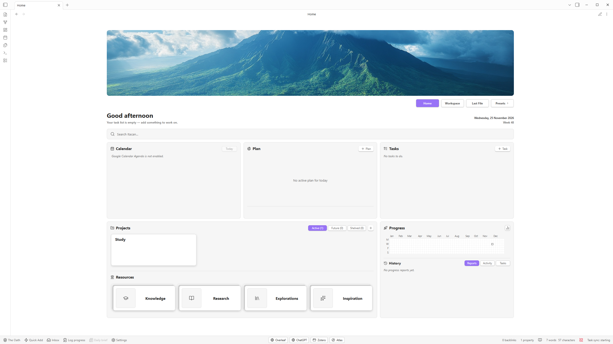](hub-home.png) | [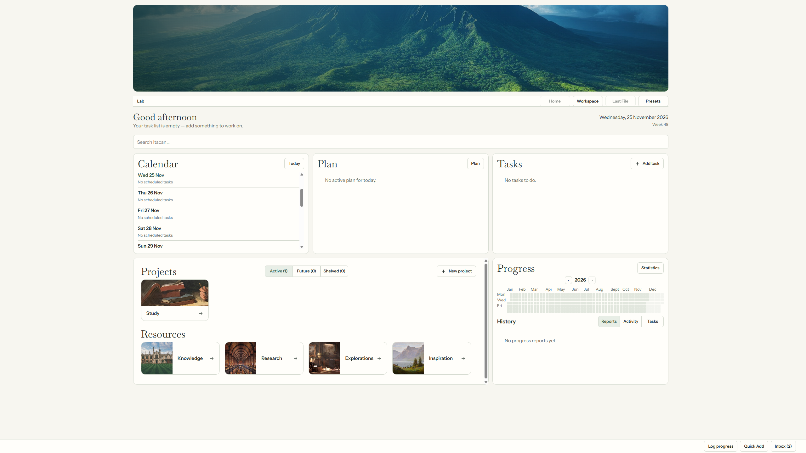](itacan-home.png) |
| Workspace | [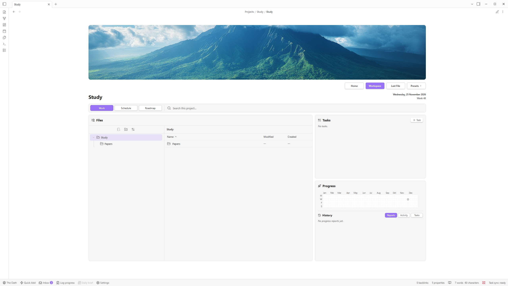](hub-workspace.png) | [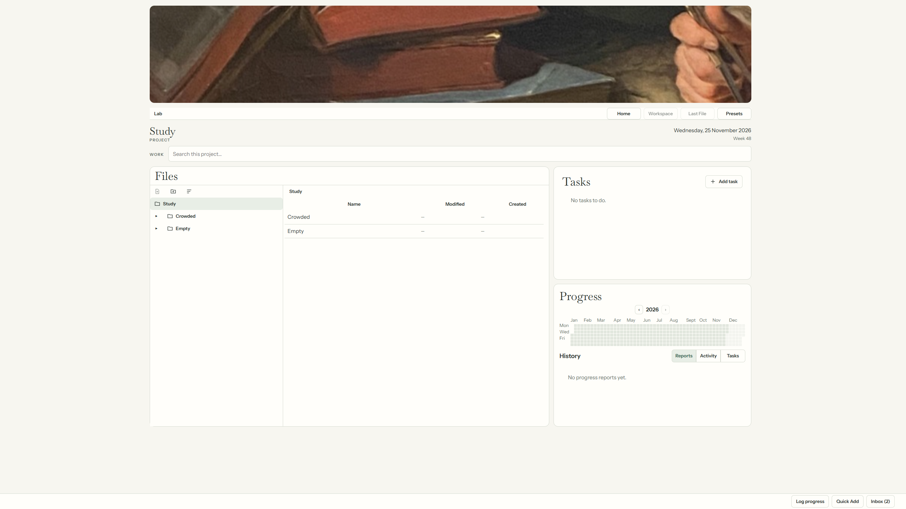](itacan-workspace.png) |
| Document | [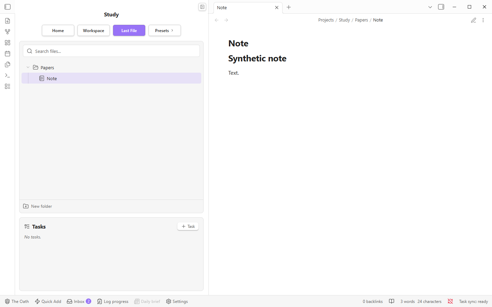](hub-document.png) | [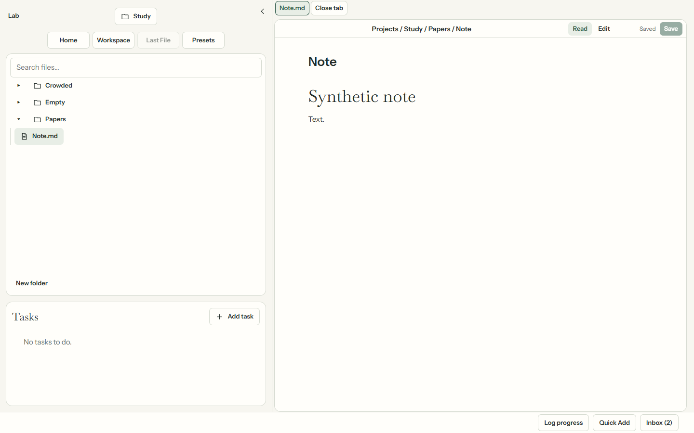](itacan-document.png) |
| Task Editor | [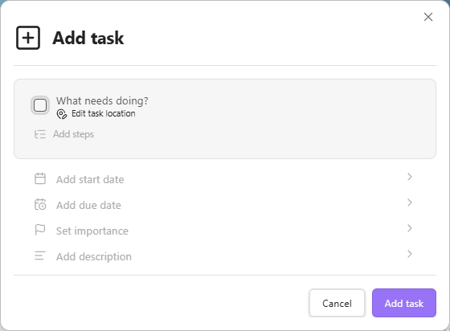](hub-task.png) | [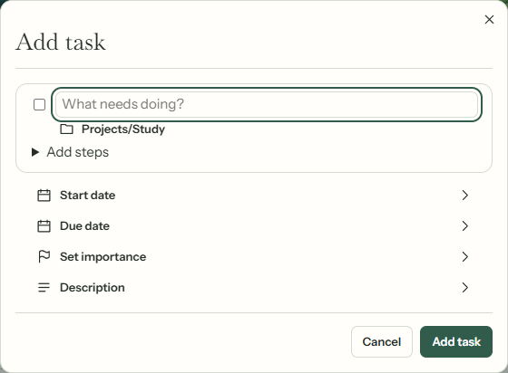](itacan-task.png) |
| Quick Add | [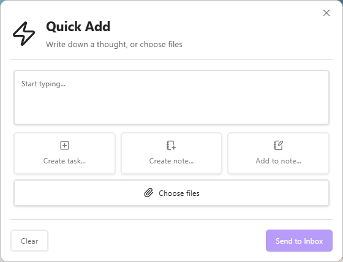](hub-quick-add.png) | [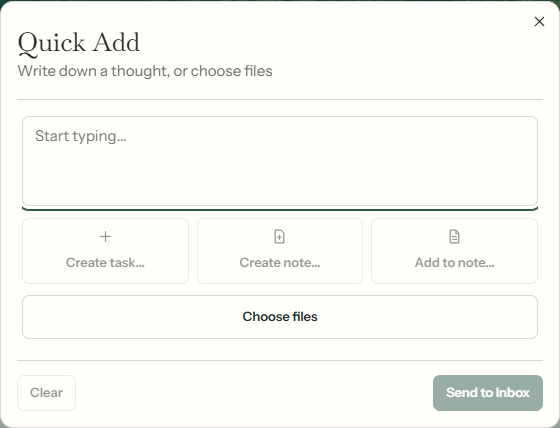](itacan-quick-add.png) |
| Inbox | [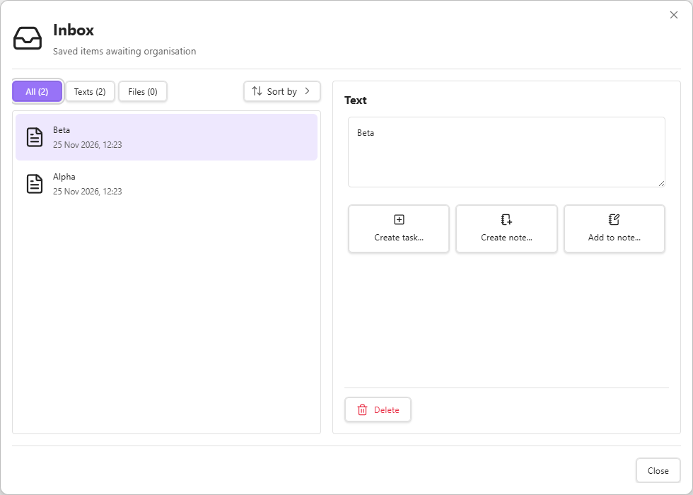](hub-inbox.png) | [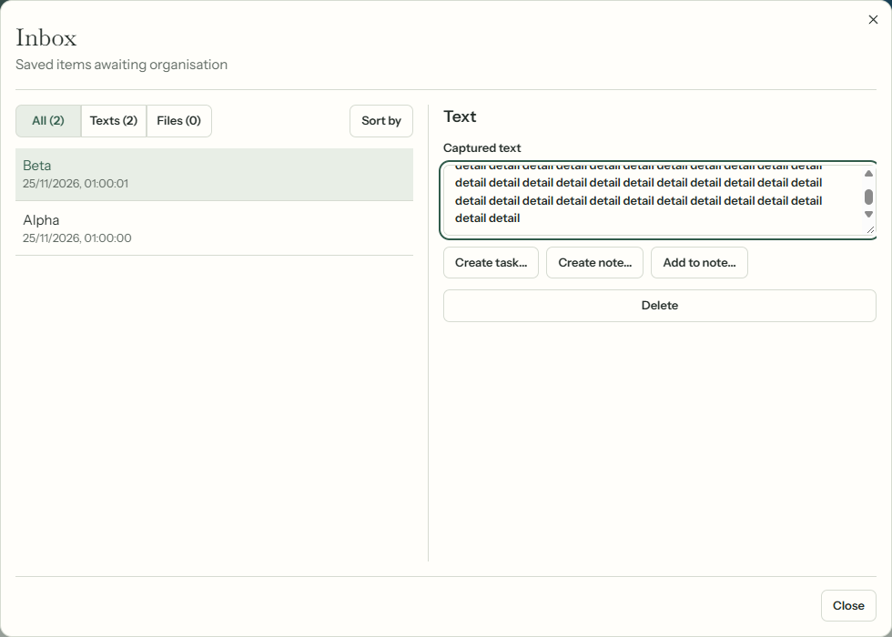](itacan-inbox.png) |

[Manual adjustment points](../../ui.md) · [Windows setup and launch](../../../README.md)
