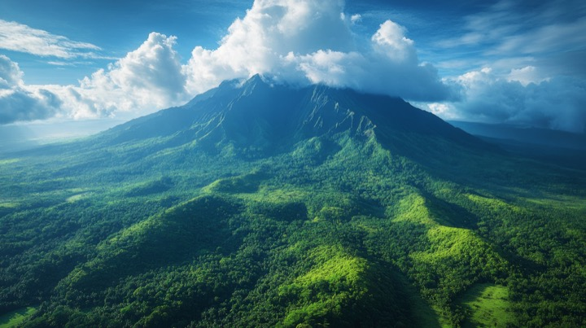

# Forest survey

Compare the canopy at the upper and lower observation points.

## Sampling

Each sample covers a square of side $s$. Its area is

$$
A = s^2
$$

Record the time and canopy density for each observation. See the [sampling protocol](<../../Resources/Research/Papers/Sampling protocol.md#method>).
