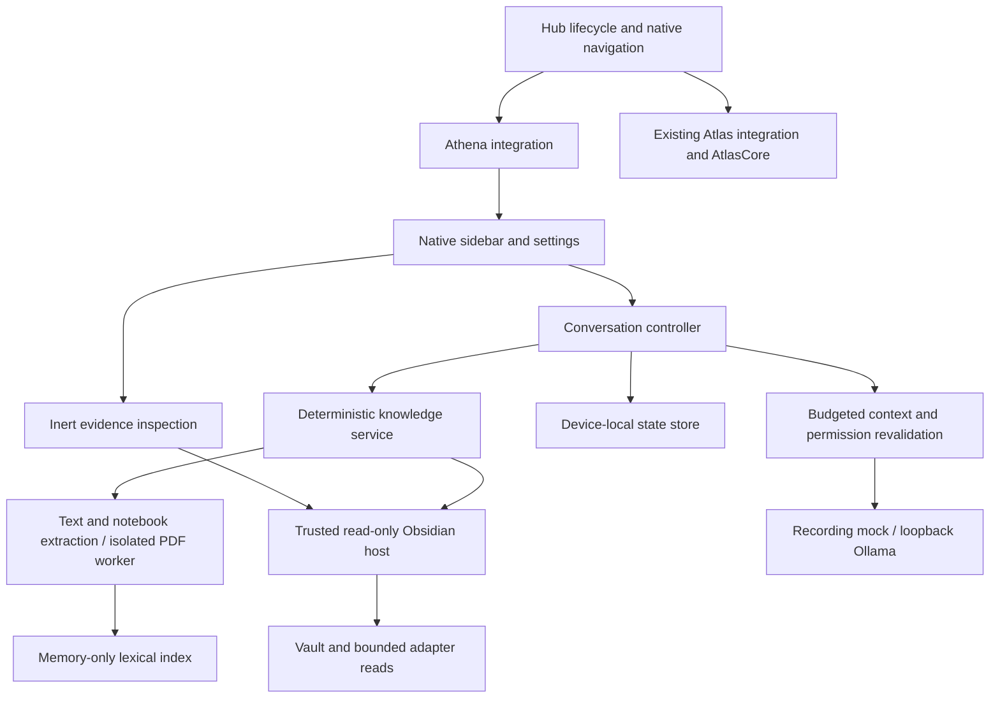

# Athena — local-first architecture and implementation roadmap

Assessment and implementation record: **19 October 2026**.
`P/` below means `.obsidian/plugins/hub-project-menu/`.

The reviewed strategy has been implemented as a desktop development candidate:
an independent knowledge kernel, recording mock, native sidebar, device-local
history, local Ollama adapter and research-file extraction. Retrieval starts
disabled and inference never connects automatically. Cloud providers, account
sign-in, credentials, a backend, file editing and model-directed tools are deferred.

**Live Ollama acceptance remains outstanding.** The protocol adapter is tested
against synthetic loopback servers; this record does not claim a successful
real-model answer, a minimum supported Ollama version, or CPU/GPU performance.
The real Obsidian acceptance fixture uses the recording mock.

## 1. Repository assessment and integration decisions

| Existing area | Assessment | Implemented boundary |
| --- | --- | --- |
| `P/plugin.js` | Owns plugin lifecycle and workspace navigation | Small guarded install/unload hook; no dashboard rewrite |
| `P/build.js` | Bundles CommonJS; does not compile TypeScript | Separately compiled Athena closure, checked by a source/artifact manifest |
| `P/lib/ui/prepared-note-rail.js` | Existing native ItemView precedent | Dedicated `hub-athena` ItemView and **Open Athena** command |
| `HubWorkspaceModeService.collapseNativeSidebars()` | Navigation normally collapses both native sidebars | Preserve the right sidebar only while Athena is visible there; explicit collapsing still works |
| `P/lib/ui/settings-pages.js` | Existing Hub settings owner and category registry | Athena category mounts its own settings presenter |
| `P/lib/services/context-search.js` | Workspace-oriented search and Markdown content reads | Remains independent; Athena discovers the eligible vault, including unregistered folders |
| `P/lib/services/data-store.js` | Useful queued-write/conflict practices, but vault-backed | Separate OS-local store; no Athena history in `data.json`, shared exports or presets |
| `P/lib/ui/markdown.js` | Uses Obsidian Markdown rendering/postprocessors | Assistant output and excerpts use inert DOM text only |
| `P/lib/services/oath.js` | Existing live `canOpen(path, false)` restrictions | Every content read and source opening intersects this permission |
| `AtlasCore/` and `P/lib/atlas/` | Separate authority and browser integration | No Athena authority imports, grants or commands; AtlasCore source is unchanged |

Git privacy is separate from retrieval eligibility. Research content ignored by
Git may be eligible locally after retrieval is enabled. Hidden configuration,
plugin implementation, credentials and authority data remain excluded.
OneDrive can synchronize ignored vault files, which is why Athena state lives
outside the vault. See [Hub persistence](Hub-personal-data.md) and
[Atlas security](Hub-atlas-security.md).

## 2. Application architecture



Providers receive application messages and selected excerpts. They receive no
Vault object, plugin instance, file handle, credential store or command bridge.
The UI subscribes to a single shared controller per plugin/vault instance.
Retrieval, extraction, hashing and ranking operate without any model connection.

### TypeScript modules and responsibilities

All source below is under `P/lib/athena/src/`.

| Module | Responsibility |
| --- | --- |
| `contracts.ts` | Provider-neutral requests/events, model descriptors, read-only host port, evidence locations, settings and versioned state |
| `integration.ts` | Construct services, register commands/views, wire Vault/Oath/focus events, mount settings and dispose resources |
| `controller.ts` | Conversation ownership, single active generation, cancellation, provider selection, provenance, transmission checks and checkpoints |
| `conversation-store.ts` | Validate restoration; mark unfinished turns interrupted; reject malformed or future schemas |
| `providers/mock.ts` | Deterministic streaming and bounded test recordings; no network/inference |
| `providers/ollama.ts` | Fixed-loopback HTTP, local-model inspection, NDJSON streaming, timeouts and normalized errors |
| `host/obsidian-host.ts` | Native Vault enumeration/reads plus bounded adapter discovery for uncatalogued code/text files |
| `host/path-guard.ts` | Validate relative paths, canonical containment and parent symlinks/junctions |
| `host/device-store.ts` | Canonical vault namespace, OS-local paths, queued atomic writes and stale-writer detection |
| `host/pdf-reader.ts` | Load the packaged worker, serialize PDF work, enforce deadline/cancellation and release Blob URLs |
| `host/source-opener.ts` | Revalidate current files and open verified Markdown/PDF file objects through native APIs |
| `knowledge/eligibility.ts` | One exclusion/format/size policy and high-confidence secret checks |
| `knowledge/documents.ts` | Discovery, IDs/revisions, incremental invalidation, extraction status, coverage and evidence revalidation |
| `knowledge/extractors.ts` | UTF-8 text, bounded title/alias metadata and notebook cell-source extraction |
| `knowledge/pdf-worker.ts` | Local PDF.js parsing with supplied bytes; no viewer, external resources or active content |
| `knowledge/chunking.ts` | Location-preserving sections, pages, cells and bounded line/column chunks |
| `knowledge/index.ts` | MiniSearch wrapper; title/alias/heading/path boosts, identifier tokenization and stable ordering |
| `knowledge/context.ts` | Trusted instructions, selected evidence, conservative context budgets and bounded history |
| `ui/sidebar.ts` | Transcript, conversation/scope controls, composer, offline search, streaming batching and view subscriptions |
| `ui/sources.ts` | Application-owned source IDs, excerpt inspection and page/line/cell labels |
| `ui/settings.ts` | Local retrieval/provider/model configuration, exclusions and local-only acknowledgement |
| `ui/safe-markdown.ts` | Safe DOM construction and inert message text; no Markdown postprocessor pipeline |

Conversation/composer presentation currently shares `ui/sidebar.ts`; a future
full workspace can extract components without replacing the controller or
retrieval contracts. No independent chat implementation is needed.

## 3. Provider and authentication boundaries

`ModelProvider` owns `descriptor`, `connect`, `listModels`, optional `prepare`,
`generate` and `disconnect`. Generation yields normalized text/completion events;
wire messages remain inside the adapter. `prepare` permits asynchronous model
inspection before the controller performs its final content/permission checks.
Context recordings can be discarded on permission changes or history deletion.

Descriptors reserve authentication modes `none`, `api-key`, `oauth` and
`backend-session`, and execution locations `mock`, `local`, `cloud`, `backend`.
**Only `none` authentication is implemented.** Model descriptors expose context,
streaming, tools, input modalities and usage capabilities; current adapters
accept text and advertise no tools. Unsupported
capability requests cannot invoke application operations.

The current transmission gate allows only the local/mock routes. Later cloud
adapters need a credential broker and separately persisted consent keyed to vault,
provider, endpoint and account. Retrieval and UI must not receive credentials.
There is no fallback from local inference to a cloud route.

No authentication SDK, commercial-model SDK or Itacan backend was added.
The Sign in with ChatGPT DevKit is excluded. Future account integrations require
official provider support and a current license/terms review.

### Ollama transport

The adapter uses Node HTTP against literal **`127.0.0.1`**, default port `11434`.
Only the port is configurable. It permits these method/endpoint pairs:

| Method | Endpoint | Purpose |
| --- | --- | --- |
| GET | `/api/version` | Diagnostics |
| GET | `/api/tags` | Downloaded model discovery and digest verification |
| POST | `/api/show` | Architecture, context limit, completion capability and remote-model metadata |
| POST | `/api/chat` | Streamed generation with explicit context/output budgets |

No redirects, hostname resolution, proxy discovery, remote URL configuration,
model downloads, daemon management or authentication headers are supported.
Metadata is bounded to 2 MiB; requests to 256 KiB; stream input to 8 MiB, with a
1 MiB buffered-line limit. Metadata timeout is five seconds; generation has a
120-second idle timeout and five-minute overall deadline. Stop destroys requests.

UTF-8 decoding spans arbitrary byte boundaries. NDJSON errors after HTTP success,
malformed events, unsolicited tool calls and incomplete EOF fail the turn and
retain a clearly marked partial answer. A final complete event without a newline
is accepted. Late events cannot update a cancelled/disposed generation.

Localhost is insufficient to establish local inference: Ollama can proxy cloud
models. Discovery and pre-generation inspection reject cloud aliases,
`remote_host`/`remote_model`, absent local digests or unsupported capabilities.
A changed digest requires reconnecting. Users must disable daemon cloud features
and acknowledge that setup before sending content. Changing port/provider clears
the acknowledgement unless a new acknowledgement is explicitly supplied.

The daemon is trusted local software; inspecting metadata cannot prove that a
modified daemon never forwards content. Official references:
[chat](https://docs.ollama.com/api/chat),
[streaming](https://docs.ollama.com/api/streaming),
[errors](https://docs.ollama.com/api/errors),
[API types](https://github.com/ollama/ollama/blob/main/api/types.go),
[local-only setup](https://docs.ollama.com/faq#how-do-i-disable-ollamas-cloud-features).

## 4. Knowledge retrieval and evidence integrity

The default enabled scope is the eligible vault. Document, folder and live Hub
project scopes narrow results. Optional active-document context is visibly
selected and frozen when the turn starts. Projects come from existing Hub records.

1. Discover app-visible files and reconcile bounded adapter-only files.
2. Apply eligibility, live Oath permission, containment and input-size checks.
3. Extract locally; never evaluate fenced code, YAML directives or notebook outputs.
4. Hash raw source bytes and assign an opaque document ID.
5. Chunk using original line/page/cell locations; retain long-line column offsets.
6. Index selected title/aliases, headings, path/identifiers and body with MiniSearch.
7. Search deterministically, narrow scope, deduplicate and bound selected evidence.
8. Re-read selected sources to verify revisions and current eligibility.
9. Budget instructions, question, evidence, recent complete history and output.
10. Verify the model, then recheck sources/permissions immediately before dispatch.

No LLM chooses search queries, files, tools or index updates. No embeddings are
required. Metadata extraction supports a limited title/alias scalar/list syntax,
not arbitrary YAML; other frontmatter remains outside searchable body text.

Create/modify/delete events invalidate affected index entries. Observed renames
preserve document identity, including folder descendants. Missed/offline renames
are not guessed. Adapter-only files reconcile on startup, window focus, five-minute
idle intervals and explicit refresh. Warm searches and provider/model changes
reuse the index; retrieval policy changes invalidate it. A failed
replacement extraction removes the previous searchable revision.

Every turn stores the exact budgeted excerpts sent, their source IDs, content
hashes and locations. The model cannot create verified source links: unknown
references remain plain text. Source inspection distinguishes current evidence
from changed/missing revisions. Native source opening repeats file checks and
uses verified file objects rather than parsing filenames as links or URLs.
Code and other unsupported native formats remain in an inert excerpt preview.

Conversation history retains transitive source dependencies. Oath-restricted
answers are hidden and excluded from subsequent prompts. Permanent exclusion
changes purge stored answers/excerpts derived from those sources, including
answers that depended on them through earlier conversation history. Moving a
source into an excluded path also purges its derived history. Model recordings
are bounded and cleared on permission/history changes.

### Supported research formats

| Formats | Extraction/location | Limitations |
| --- | --- | --- |
| Markdown | Raw text, headings, selected metadata; original source lines | Fences/LaTeX remain inert source |
| Searchable PDF | Local PDF.js text; physical page and extracted text lines | Columns, fonts, equations and figures can lose meaning; no OCR/vision |
| Code, including Python/TS/JS/C/C++/Java/Rust and shell scripts | UTF-8 source; original line/column ranges | No execution, compilation, imports or AST navigation |
| LaTeX/BibTeX | Raw UTF-8 source and lines | No compilation, shell escapes or bibliography resolution |
| TXT/JSON/YAML/TOML/INI/logs | Bounded UTF-8 text and lines | Secret checks apply; no configuration evaluation |
| CSV/TSV | Text and physical source lines | Multiline quoted fields do not have logical spreadsheet row citations |
| Jupyter notebooks | Bounded JSON; Markdown/code cell sources and cell-relative lines | Outputs, attachments, embedded HTML and irrelevant metadata excluded |
| HTML/XML/CSS/SQL | Raw text/source lines | No HTML rendering, resource loading, SQL or shell execution |
| Scanned/encrypted/malformed PDFs | Distinct scanned/password/failure statuses | No OCR or password entry |
| Office/ODF/proprietary binaries/images | Unsupported status | Dedicated future parsers/capabilities required |

The PDF bundle contains parsing code and a worker protocol, without the viewer,
font/CMap/WASM assets or native canvas binaries. Workers cannot fetch external
resources or scripts. Some PDFs requiring those assets will fail or extract
partially. Empty pages in otherwise searchable files are reported as partial
coverage. Extraction details expose notices; no PDF layout-fidelity guarantee is
made. Workers are disposable responsiveness boundaries, not OS memory sandboxes.

### Initial resource limits

| Resource | Implemented default |
| --- | --- |
| Ordinary UTF-8 text | 2 MiB/file |
| Notebook input | 5 MiB; 10,000 cells; 2,000,000 extracted characters |
| PDF input | 25 MiB; 500 pages; 2,000,000 extracted characters |
| PDF work | One worker at a time; 30-second deadline; cancellable |
| Ordinary extraction | Four concurrent reads; yield between documents |
| Discovery | 20,000 directory/file reconciliation guard |
| Index | Memory only; 10,000 documents and 50 MiB extracted-text ceiling |
| Evidence | Six chunks across four files; further reduced by context budget |
| Generation | One active turn per vault; 100,000 response characters |
| Model context/output | Initial 4,096 context, configurable to verified limits; 512 output tokens |
| Persisted state | 16 MiB; explicit conversation deletion controls |

UTF-8/JSON byte counts conservatively estimate text tokens; template/output
overhead is reserved. Questions that exceed the budget fail explicitly. Excerpts
may be shortened, with corresponding location updates; dropped evidence receives
no source entry. Coverage reports skipped files and incomplete/capacity states.
The 50 MiB text ceiling is not a 50 MiB process-memory ceiling.

## 5. Persistent state and sidebar lifecycle

Device roots are `%LOCALAPPDATA%/Itacan/Athena` on Windows,
`~/Library/Application Support/Itacan/Athena` on macOS, and
`$XDG_DATA_HOME/itacan/athena` (or `~/.local/share/itacan/athena`) on Linux.
Each canonical vault path receives an opaque SHA-256 namespace under `vaults/`.
Same-name and copied vaults at different locations remain independent.

One versioned `state.json` owns settings, conversations/evidence and the document
identity manifest. The index is disposable memory state. View restoration stores
only a conversation ID; it stores no credentials or excerpts in workspace layouts.
There is no shared-project/preset/Hub-backup export path.

The store verifies that existing/redirected ancestors resolve outside the vault
before creating directories. Writes are queued temp-file/fsync/rename replacements;
an observed external revision rejects stale saves. This is not a cross-process
transaction or merge service. Malformed/future state remains recoverable on disk
and fails locally rather than silently replacing history. OS account permissions
protect default history; Athena does not encrypt it and OS backups may retain it.

The sidebar includes provider/model status, conversations, scope/active-context
controls, transcript, extraction details, source excerpts, offline search,
composer, Send and Stop. It reuses Hub typography and button conventions.
Streaming is plain text with stable message DOM identity and approximately 50 ms
view batches. Drafts, IME composition, selection and scroll intent are preserved.
Auto-scroll occurs only near the bottom. Views release subscriptions on close;
the last view closing cancels generation. Stop also cancels indexing/search.
Provider/model replacement and unload abort active work. Turn boundaries and
bounded partial checkpoints persist; restored incomplete turns become interrupted.
Native Vault reads have no cancellation primitive: Stop releases Athena's caller
and discards late results, while an already issued OS read may finish.

## 6. Security and privacy requirements

| Boundary/threat | Implemented mitigation | Evidence or remaining limitation |
| --- | --- | --- |
| Prompt injection asks for privileged files/actions | No model-controlled operations, tools, shell or writes; only preselected text reaches provider | Synthetic injected instructions cause no additional file access |
| Protected data enters retrieval | Active custom config directory, hidden paths, dependencies/caches, Hub infrastructure/backups/migrations, AtlasCore/authority, credential names/extensions and user exclusions | Policy tests and real-vault read recording; filename/content heuristics cannot find every secret |
| Path traversal or symlink/junction escape | Reject invalid references before normalization; realpath containment and lstat of parents | Synthetic filesystem/junction tests; concurrent malicious OS writers are outside this app-level guarantee |
| Generated HTML/plugin code executes or fetches data | Text-only DOM rendering; no raw HTML, embeds, remote images, MarkdownRenderer or Dataview postprocessors | Browser/Obsidian injection fixtures remain inert |
| Local endpoint proxies to cloud | Fixed IP/route policy, no redirects, local digest/capability validation before every generation, local-only setup acknowledgement | Cloud aliases/metadata rejected before test-server inference; daemon configuration/live proof remains required |
| Permission changes retain usable context | Live Oath checks, cancellation, index invalidation, transitive history filtering and permanent-exclusion purge | Unit and browser permission-change fixtures |
| Stale sources supply false locations | Raw-byte revisions, fresh revalidation and historical evidence manifests | Edit/rename/delete/replacement tests; historical citations are provenance, not proof of a claim |
| PDF/notebook resource exhaustion | Input/output/page/cell limits, deadline, worker termination and bounded concurrency | Synthetic malformed/scanned/oversized inputs; parser bugs still require dependency updates |
| Sync/cross-vault state leakage | OS-local store, canonical path namespace, no basename identity or shared-state route | Same-name/copy/junction/stale-writer tests and actual plugin reload |
| Athena disrupts Hub/Atlas | Guarded lifecycle hook, no Atlas authority reference, narrow sidebar preservation | Full Node regressions, existing browser/native Atlas regressions, real isolated Obsidian checks |

Runtime dependencies are pinned **MiniSearch 7.2.0 (MIT)** and
**PDF.js 5.4.624 (Apache-2.0)**. Their notices/license texts ship with the assets.
The runtime npm audit on this date reported zero known vulnerabilities; that is
a dependency-database check, not proof of complete parser safety.
See [third-party notices](../.obsidian/plugins/hub-project-menu/lib/athena/THIRD_PARTY_NOTICES.md).
Repository-wide commercial distribution rights still require the existing
project-level licensing decision before an external release.

## 7. Build and validation

Fresh clones run the shipped `main.js`, compiled Athena closure and PDF worker
without installing Athena npm dependencies. Developers editing Athena use its
separate pinned lockfile/toolchain; Atlas development dependencies are not reused
by the Athena build. Obsidian and Node built-ins stay external.

From the vault root in PowerShell:

```powershell
npm.cmd ci --prefix .obsidian/plugins/hub-project-menu/lib/athena --ignore-scripts --no-audit --no-fund
node .obsidian/plugins/hub-project-menu/lib/athena/node_modules/typescript/bin/tsc --noEmit -p .obsidian/plugins/hub-project-menu/lib/athena/tsconfig.json
node .obsidian/plugins/hub-project-menu/build-athena.js
node .obsidian/plugins/hub-project-menu/build.js
node .obsidian/plugins/hub-project-menu/lib/athena/tests/run.cjs
node .obsidian/plugins/hub-project-menu/lib/athena/tests/packaging.cjs
node .obsidian/plugins/hub-project-menu/lib/athena/tests/benchmark.cjs
node .obsidian/plugins/hub-project-menu/lib/athena/tests/launch-browser.cjs
node .obsidian/plugins/hub-project-menu/lib/athena/tests/launch-obsidian.cjs
```

The last two commands use the existing development-only pinned Electron from
Atlas's native fixtures. The Obsidian fixture additionally uses an installed
`obsidian.asar`; set `ATHENA_OBSIDIAN_ARCHIVE` when it is outside the default
Windows local-programs directory. It launches hidden, uses a generated synthetic
vault/profile, overrides only its own device-store location, blocks external
browser requests and removes that temporary environment on completion.
No personal vault or real credentials are loaded.

`build-athena.js` emits `runtime.cjs`, the isolated worker, license copies and a
manifest covering source/configuration/lockfile/artifact hashes. `build.js`
refuses stale sources and packages worker/notices/licenses for `--output-dir`.
Keep generated artifacts with their sources when distributing changes.

### Completed validation

| Check | Result |
| --- | --- |
| Athena synthetic Node regressions | 22 passed |
| Full Hub Node suite, including native-sidebar policy | 91 passed |
| Atlas adapter Node suite | 93 passed |
| AtlasCore Node suite | 191 passed; source unchanged |
| Athena/Atlas adapter/AtlasCore TypeScript checks | Passed without emitting |
| Existing Hub/Atlas browser fixtures | Seven passed |
| Existing native Atlas regressions | 22 passed |
| Athena Electron fixture | PDF/page/scanned status, inert rendering, offline search, permission changes, endpoint consent, 50 presenter cycles, focus/drafts and narrow widths passed |
| Real isolated Obsidian | Native command/sidebar/settings, genuine Markdown/PDF/code reads, protected/excluded read denial, PDF worker packaging, Markdown opening and native PDF page-two navigation, history reload, IME/drafts, sidebar collapse behavior, 50 native view cycles and light/dark layouts passed |
| Runtime dependency audit | Zero known advisories reported |
| Production export | Runtime/worker/license hashes verified; main loads with npm package lookup disabled |

The tested Windows application matrix is **Obsidian 1.12.7**, pinned
**Electron 39.8.3 / Chromium 142.0.7444.265 / Node 22.22.1**. The harness loads the
installed application archive in the pinned hidden Electron host; this is not a
test of every Obsidian installer/Electron combination or the declared 1.5.0
minimum. Unsupported PDF worker/runtime features fail within Athena.

The scale harness used Windows, Node 24.19.0, an Intel i7-13700KF and 32 GiB RAM.
It extracted/indexed **5,000 synthetic Markdown documents, 52,425,000 bytes**,
in **13,865 ms**. Across 300 warm searches with evidence revalidation, p95 was
**28.41 ms**; all 100 fixture queries found their expected source within the
returned top five. End-of-run process RSS was **796 MiB**, including the in-memory
synthetic corpus and harness/query allocations. This is a lexical kernel benchmark,
not a PDF-heavy disk startup benchmark, general semantic-quality evaluation,
low-memory-device qualification or inference measurement. A persistent index
remains deferred; memory measurements warrant further work before raising limits.

## 8. Milestones, tests and acceptance gates

| Milestone | Implementation and acceptance | Current status |
| --- | --- | --- |
| M0: architecture assessment | Repository map, read-only/provider/state boundaries, file matrix and testable roadmap reviewed before implementation | Reviewed; this document records implementation and remaining gates |
| M1: knowledge kernel + recording mock | Independent TS build; arbitrary-folder Markdown; protected/excluded files never read; exact line/revision manifests; edit/rename/delete invalidation; mock receives exactly approved context | Implemented and automated acceptance passed |
| M2: sidebar + persistence | Existing Hub settings; native sidebar reuse; 50 open/close cycles without listener growth; source inspection; restart restoration; safe rendering; cancellation, draft/IME/selection and narrow/theme layouts | Implemented; synthetic browser and real isolated Obsidian acceptance passed |
| M3: local Ollama | Model discovery/revalidation, streamed generation, cancellation/errors/budgets; actual synthetic-fact answer through an already downloaded local model, with external connectivity disabled | Adapter and protocol tests complete; **real-daemon/model proof still required** |
| M4: research formats | PDF page, text/code line and notebook-cell evidence; no execution; clear malformed/scanned/password/oversize/timeout statuses; worker packaging tested in Obsidian | Implemented; common PDF packaging verified. Broader scientific-PDF corpus and live-model acceptance remain release gates |
| M5: retrieval quality/scale | 5,000-document/~50 MiB reference corpus; warm p95 <250 ms and expected source in top five for >=90% of declared lexical queries | Initial synthetic benchmark passes. Disk/mixed-PDF/low-memory measurements, richer evaluation set and any persistent cache remain future work |

M1–M3 define the Markdown prototype. M1–M4 define the research release **after**
the remaining live-inference and compatibility gates pass. Code availability is
not a claim that those release gates have been completed.

### Local Ollama proof-of-concept procedure

Use an isolated vault containing synthetic facts. No account or backend is needed.

1. Record actual Obsidian/Electron/Node, Ollama version, model digest/quantization,
   hardware and configured context. Use an already downloaded completion model.
2. Disable Ollama cloud features according to its documentation and restart the
   daemon. Verify the complete test with external connectivity unavailable.
3. Enable Athena retrieval, select Ollama/port, explicitly acknowledge local-only
   setup, connect and choose a model that passes metadata checks.
4. Ask for a synthetic Markdown fact. Inspect exactly which excerpts were sent;
   verify the answer cites supplied source IDs. Repeat for code and a searchable PDF.
5. Test Stop, a stopped daemon, missing/changed model, oversized question/context,
   interrupted generation, switching models and final-view closure.
6. Confirm offline vault search still works with the daemon stopped. Confirm no
   model download, remote endpoint or automatic cloud fallback occurs.
7. Record first-token latency, generation rate, memory and cancellation latency.
   Preserve the model/version matrix and observed limitations with this report.

Protocol faults, redirects, remote metadata, split UTF-8 and tool-call rejection
are already covered by deterministic loopback fixtures; they do not replace this
real-engine proof. Athena does not install/start models or alter daemon settings.

### Explicitly deferred work

| Milestone/integration | Reserved boundary and prerequisites |
| --- | --- |
| M6: full workspace | Reuse controller, source and composer services; no second conversation system |
| M7: edit proposals | Separate preview/diff/approval/revision/recovery specification; no current write port |
| M8: commercial APIs | Provider adapters plus protected credential broker and per-provider transmission consent |
| Official OAuth/account sign-in | Separate authentication mechanism and license/terms review; retrieval/UI remain credential-free |
| Optional Itacan backend | New `backend-session` adapter and explicit endpoint/account/privacy policy |
| Embeddings/OCR/vision/Office parsers | Separate measured need, packaging, resource limits and privacy/capability tests |
| Persistent index | Disposable OS-local cache only when measured startup/memory tradeoffs justify it |
| Mobile | Separate runtime/transport design; mobile localhost refers to that mobile device, not the desktop daemon |

Windows is the tested desktop platform. macOS and Linux have local-store path
implementations but remain unvalidated runtime targets. No AtlasCore refactor,
cloud authentication or server-side implementation is part of this change.

## 9. Trying the development candidate

Reload the Hub plugin, open **Hub Settings → Athena**, choose **Recording mock**,
enable local retrieval, add exclusions and save. Open Athena from Settings or
the command palette. **Search vault** retrieves inspectable evidence without a
provider; **Connect** then **Send** exercises deterministic mock conversations.

For an existing locally configured Ollama daemon, select **Ollama**, verify its
local-only setup, acknowledge that setup, save, connect and select a verified
downloaded model. Treat live-model operation as experimental until the proof
above is recorded. Do not send protected data merely because a daemon is local.
Nothing in this change signs into an account, downloads a model or edits notes.
