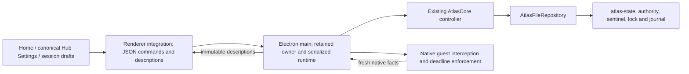

# Atlas–Obsidian Hub Storage Reliability and Recovery

Date: 2026-10-26. Baseline: `d5087e3`. Active checkout: `C:\Users\jinhao\OneDrive\obsidian-hub`; the configured Desktop checkout does not exist. This work modifies local source and tests only. No commit, push, release or deployment was performed. Installed `main.js` and `atlas-native.cjs` remain byte for byte identical to their pre-task copies. Concurrently created `.itacan-native/` application records were left alone.

## Findings and outcome

Hub had the same persistent-outage mechanism as Firefox 0.1.16: a definitely failed save could leave Core unavailable even after storage became healthy. Its backend is a filesystem journal, not IndexedDB. Ordinary warmed filesystem loads already performed no writes.

The repair adds one narrowly eligible recovery attempt through the existing controller, fixes inconsistent read/settlement proofs, preserves valid browsing after a definitely aborted display save, completes interrupted acknowledgement of this instance's own lock, and fences destroyed views and late replies. A separate timing-form remount race is also repaired. Core source, authorization rules, authority schema, Firefox code and curated presets are unchanged.

Evidence distinguishes controlled faults from observed product incidents. The original user's device failure was not reproduced or attributed to quota, antivirus or OneDrive. The controlled external-write race demonstrates a real implementation defect; it does not demonstrate a website obtaining filesystem access.

## A. Architecture and state flow

Paths in this report are relative to `.obsidian/plugins/hub-project-menu/`, unless stated otherwise.

### Ownership and boundaries

`plugin.js` installs `obsidian/integration.js` during plugin startup. The renderer loads the main-process `atlas-native.cjs` through Obsidian's desktop bridge. `obsidian/native.js` caches one owner per resolved plugin directory, normalizing case on Windows, and refuses a conflicting vault session partition. That owner holds one repository, clock, Core controller, managed-list service and native guard. Settings, Home and multiple renderer windows do not independently own executable authority.

The runtime serializes navigation facts, Core operations, metadata saves and observations. Core has its own serialized controller interface. Renderer descriptions and presentation caches support display only; every actual navigation passes current Core checks and repository validation. Revisions on destination drafts reject stale edits. Display labels, categories and pins never confer host access.

`obsidian/webviewer.js` correlates native main-frame requests, redirect/arrival facts and context generations. A released request stays within queue ownership until native continuation acknowledges. Retained pages are rechecked, and independent native timers enforce finite grant/Journey deadlines while a new page is stalled. Popup and download denial, exact-host scope and Blacklist precedence remain intact.

### Actual persistence backend

Atlas authority is not stored in IndexedDB, localStorage or Obsidian `saveData()`. It lives under the plugin's `atlas-state/`:

| Record | Role |
| --- | --- |
| `authority.json` | Schema 2 Core snapshot, storage version, last commit identity and application metadata: destinations, pins, pending metadata and durable proposal-recovery copy |
| `initialized` | Sentinel preventing interrupted setup or missing initialized authority from looking like unused storage |
| `owner.lock`, `reclaim.lock` | Cooperative local ownership and serialized dead-owner reclamation |
| `pending.json` | Single write-ahead journal: commit identity, before/after hashes and proposed storage version |
| `.authority-*.tmp` | Candidate file before atomic replacement |
| `managed-cache.json` | Separate operational managed-list cache; not a second policy authority |

A write checks ownership and exact loaded bytes/version, validates the entire candidate, writes and fsyncs a unique candidate, writes and fsyncs the journal, checks ownership/current bytes again, renames on the same volume, validates settlement and removes the matching journal. Core receives acknowledgement only after this sequence. Application metadata uses the same journal and replacement path, remaining outside Core's closed authority envelope.

Filesystem mutations finish synchronously in the main process. On Windows, Node does not provide the directory-fsync step used on supported platforms. This is not evidence of physical power-loss durability, coherent multi-device synchronization or a filesystem transaction spanning all records.

Hub's unrelated application/workspace persistence is a separate boundary in `lib/services/data-store.js`: legacy storage includes plugin-data saves and device/shared records; explicit managed construction delegates to application-storage transactions. Those stores and the concurrently generated `.itacan-native/` records do not back Atlas authorization and were not changed.

### Reads, checkpoints and lifecycle

Twenty warmed repository loads plus runtime descriptions were instrumented: zero `writeFileSync`, `fsyncSync` or `renameSync` calls. First owner acquisition, explicit setup and legacy migration intentionally write. Home/Settings refresh reads descriptions rather than saving a new authority snapshot.

Core navigation/clock operations can legitimately persist changed observation checkpoints. These protect rollback detection, original deadlines and restart semantics; they are not the Firefox unnecessary read-write-transaction bug. Removing or debouncing those saves without a new consistency design was rejected.

Closing Settings retains renderer-session drafts. Reopening it uses the same shared Settings owner. Destroying a renderer integration disposes its drafts/subscriptions and rejects new commands; an already accepted native operation may still complete, but its late reply cannot acknowledge success into the destroyed integration. A new view must inspect actual saved state.

When the last client unsubscribes, native enforcement/runtime suspend and guests close. Native hooks and the controller remain retained for plugin reload, preserving uncertain commits and clock floors. Reactivation reuses the same owner and reconciles through Core. Full application restart creates a new owner and restores saved grants, requests, configuration and proposals; old Journey bindings end rather than adopting new browser provenance. Shutdown releases native hooks/ownership. Abrupt termination during synchronous persistence is handled conservatively by the journal/sentinel on restart; physical crash ordering remains unverified.

## B. Comparison with Firefox 0.1.17

Read-only adjacent reference material: `AtlasCore/docs/firefox-storage-reliability.md`, its JSON evidence, `extension/src/storage/indexeddb-repository.ts`, targeted Firefox adapter recovery code and its storage/startup/Journey tests. Firefox was not modified.

| Firefox finding | Hub assessment | Evidence / response |
| --- | --- | --- |
| Definitely failed save leaves controller unavailable indefinitely | Affected through the same controller-state mechanism | Baseline candidate-open EBUSY leaves `UNAVAILABLE/WRITE_FAILED`; healthy observations do not recover; explicit recovery succeeds |
| Ordinary reads use unnecessary strict write transactions | Not affected by that backend issue | No authority IndexedDB; warmed loads have zero filesystem mutations. Required Core time checkpoints remain |
| Safe cause information hidden behind WRITE_FAILED | Affected | Added closed cause/stage/outcome codes and bounded process-local counters |
| One guarded same-controller recovery | Previously missing | Added only for confirmed NOT_WRITTEN eligible Core writes |
| Unknown commits and quota must remain manual/fenced | Applicable, preserved | Journal acknowledgement loss and real Windows sharing violation never trigger automatic replay |
| Recovery cannot renew confirmations or lost Journeys | Applicable, verified | Requests, grants and Vault candidates retain exact terms; Core.open ends old Journeys |
| Unbounded commit receipt history | Not the same structure | One journal and one last commit identity; no receipt array. Distinct-context ended Journey history still grows |

## C. Root causes and additional findings

Priorities distinguish reproduced bugs from risks. P1 means repair before adoption; P2 means follow-up design or moderate availability/UI impact.

| ID / severity | Reproduction and responsible component | Repair / evidence |
| --- | --- | --- |
| S1 High / P1: transient failure becomes persistent outage | Fail the real candidate-file open once with EBUSY before journaling. Old `runtime.observe()` returns early while unavailable; Core.handle also refuses ordinary operations | Same-controller bounded recovery. Baseline remains UNAVAILABLE after healthy storage; repaired run is READY with unchanged policy |
| S2 High / P1: validated authority differs from cached CAS proof | In old `persistence.load()`, return bytes A from validation read while replacing disk with B; a second read caches B but returns snapshot A. Injecting a Blacklist addition this way lets a later checkpoint overwrite that addition and release the formerly trusted host | Cache exactly validated bytes. Repaired run preserves the revocation, remains unavailable and releases no navigation |
| S3 High / P1: settlement proof/re-read and journal cleanup races | Replace authority after its settlement read, or replace pending journal before cleanup. Old resolution performs another unchecked authority read and cleanup does not match the journal it deletes | Settlement returns its exact validated bytes/envelope; resolution retains those bytes. Cleanup verifies journal identity/content. Replacement journal remains intact and unresolved |
| S4 Medium / P2: own lock acknowledgement becomes a lockout | Fail fsync after creating this instance's lock. Old retry treats its still-live PID as a different owner and stays STORAGE_LOCKED | Reflush/revalidate only an exact machine/PID/random-instance lock match. Windows requires a writable handle for fsync. Foreign/live owners remain rejected |
| S5 Medium / P2: harmless display failure closes valid pages | Fail a name/category/pin candidate before journal creation. Old `savePresentation()` closes all content even while Core remains READY | Proven NOT_WRITTEN metadata saves keep independent authority, return truthful unsaved feedback, and still perform a fresh Core observation. Unknown outcomes remain fenced |
| S6 Medium / P1 lifecycle hardening: late effects and commands | Hold a real repository load during retained-page checking, close the context, then release it. Old recheck can lease the dead context. Renderer bridge also accepts calls after destruction | Generation/document checks after awaits; suspended/closed command guards; late accepted replies become unresolved rather than false success. Native renderer regressions cover bridge destruction |
| S7 Medium / P2: timing save remount race | Hold PROPOSE_SETTINGS, close/reopen Settings, then acknowledge the original save. Reproduced old failure: remounted inputs enabled and live form not correctly cleared | Identity-owned timing session, busy remount locking, matching-model acknowledgement and live-mount refresh. Browser test asserts one exact proposal, unchanged active terms and no duplicate submission |
| S8 Medium / P2 architectural growth | Open/finish/close distinct context IDs. Ended Journey records persist; distinct expired request/grant scopes can also remain | Measured and documented; no naive pruning or Core change |
| S9 High impact / P2 architectural limitation | Locks/CAS are cooperative file protocols, not a distributed transaction. A noncooperating writer can still race the last check and rename/unlink | Narrow reproduced read-proof defects fixed. General cross-process/sync atomicity is not claimed; requires separate ownership/storage design |

S2/S3 are deterministic controlled external-writer failures, not reports of an observed malicious site or confirmed OneDrive event. The tests show that the intended external-change fence was defective. A local actor that can arbitrarily modify authority files is outside the website boundary.

Malformed/corrupt state, foreign owners, interrupted reclamation, clock rollback and journal/authority mismatches already failed closed. Regression tests retain that behavior; none is solved by silently reinitializing or deleting the user's records.

## D. Implemented changes and recovery contract

### Eligible automatic recovery

Eligibility requires all of the following:

1. Runtime enabled, no startup/manual open in progress, no reentrant recovery and unused recovery credit.
2. Core reports `UNAVAILABLE / WRITE_FAILED` with no unresolved commit identity.
3. The repository's actual last failed operation is a Core COMMIT, its outcome is definitely NOT_WRITTEN, and its safe cause is BUSY, INTERRUPTED or IO_ERROR.
4. NOT_WRITTEN proof requires no pending journal, unchanged authority bytes and retained ownership. An exception alone is insufficient.

The runtime spends its single credit before opening the existing controller. It does not replace the repository, owner, clock or controller. Core reloads and validates all authority, preserves its clock floor, retires old Journeys and acknowledges any necessary recovery save before READY.

Loading flights lose their provenance and close; no URL, POST body or held request is replayed. Already displayed pages survive only if a fresh Core check establishes independent current access. Lost intermediate Journeys cannot authorize retention. Only a pure CHECK_NAVIGATION or OBSERVE_TIME may be reassessed after recovery. BEGIN, Start, Cancel, proposal creation, grants and confirmations return their original failure and require explicit user action.

An independent healthy queued Core operation can establish a new failure episode; internal recovery work cannot replenish its own credit. A failed manual recovery also leaves automatic credit spent. Persistent candidate failure produces two candidate attempts (the original and one recovery attempt), then fifty further observations produce no writes or resets. The existing native observation timer is reused; no retry timer or periodic controller reconstruction was introduced.

Automatic recovery excludes capacity/quota, access denial, read-only storage, resource limits, unknown causes, load/validation failures, ownership changes, conflicts, corrupt state, clock problems, migration uncertainty and all UNKNOWN journal outcomes. Explicit Recover saved state remains available. It resolves the exact prior commit through Core; it does not retry that operation.

### Diagnostics and compatibility

`storage-diagnostics.js` holds saturating scalar counters and a single safe failure tuple: operation, stage, cause and outcome. It never retains raw messages, exception objects, paths, URLs, tokens or snapshots. Error codes use an own-property closed mapping, including hostile prototype-key tests. Failure to obtain diagnostics cannot disable otherwise healthy authorization.

Diagnostics distinguish initialization, verified loads, journaled writes, committed/NOT_WRITTEN/UNKNOWN/conflict results, migrations, reconciliation and automatic/manual recovery outcomes. They appear in the existing Diagnostics / Recovery technical details and unavailable-startup explanation. Capacity/access explanations do not assert the user's actual incident cause.

Healthy counter increments do not drive broad renderer publication; failure/recovery changes do. Six retained diagnostic text nodes preserve existing forms and disclosures. Browser regressions verify draft input identity, caret selection and absence of automatic command submission.

The main/renderer compatibility marker advances from 4 to 5 so a future renderer build cannot silently use retained native code lacking these guards. Older native code is quarantined and requires a full Obsidian restart after a separately authorized deployment. No authority schema or transport command changed. This task has not deployed either bundle.

### Changed files

All plugin paths below use the prefix stated in section A.

| Files | Responsibility |
| --- | --- |
| `lib/atlas/obsidian/persistence.js` | Validated-byte proofs, matching journal cleanup, own-lock acknowledgement, migration uncertainty, narrowly safe temp cleanup and diagnostic instrumentation |
| `lib/atlas/obsidian/storage-diagnostics.js` (new) | Closed safe causes and bounded memory-only counters |
| `lib/atlas/obsidian/runtime.js` | One eligible same-owner recovery, no replay, lifecycle fences and display-failure behavior |
| `lib/atlas/obsidian/integration.js`, `native.js` | Destroyed bridge/launch guards and compatibility marker 5 |
| `lib/atlas/obsidian/presentation.js` | Include failure/recovery changes without per-load UI invalidation |
| `lib/atlas/obsidian/feedback.js`, `settings-ui.js` | Safe existing-surface diagnostics, honest save/recovery feedback and timing remount repair |
| `lib/atlas/obsidian/session.js` | Matching-model timing acknowledgement |
| `lib/atlas/tests/storage-reliability.test.js` (new) | 23 storage, authority, recovery and lifecycle regressions |
| `lib/atlas/tests/storage-reliability-probe.cjs`, `storage-reliability-evidence.json` (new) | Reproducible baseline/final probe and actual synthetic evidence |
| `lib/atlas/tests/native/launch.cjs` | Build into an isolated temporary directory, rather than testing/deploying installed bundles |
| `lib/atlas/tests/native/runner.cjs`, `renderer-fixture.cjs` | Three additional native cases, late-reply tests and discover installed Obsidian theme archive after application update |
| `lib/tests/atlas-workflow.html` | Pending timing save across remount and diagnostic/draft/caret regressions |
| `System/Hub-atlas-storage-reliability-and-recovery.md` | This report |

## E. Verification and evidence

Environment: Windows, Node 24.19.0; Electron 39.8.3 / Chromium 142.0.7444.265; final native theme checks read installed Obsidian 1.14.5 CSS. All authority tests use synthetic temporary repositories; no live Atlas directory was read, reset or modified.

[Raw before/after evidence](../.obsidian/plugins/hub-project-menu/lib/atlas/tests/storage-reliability-evidence.json) compares the pre-change archived source with current source. Archived persistence/runtime/integration/Settings sources were checked against HEAD before using them as baseline. [Probe source](../.obsidian/plugins/hub-project-menu/lib/atlas/tests/storage-reliability-probe.cjs) accepts `ATLAS_STORAGE_SOURCE` for an exported baseline and `ATLAS_STORAGE_EVIDENCE_OUTPUT` for optional JSON output. Without an override it tests current source and prints only synthetic results.

| Required scenario | Actual verification |
| --- | --- |
| A: transient write | Inject one EBUSY/EINTR/EIO at candidate open around real filesystem calls; reload/validate/save before READY; actual native page retained with no new network request; Blacklist remains denied |
| B: persistent write | Persistent candidate faults, fifty further observations, bounded write/recovery counts, guest closure, failed manual attempt does not rearm auto recovery, healthy explicit manual recovery succeeds |
| C: unknown outcome | Execute the real rename, then throw to lose acknowledgement. Policy confirmation is not repeated; state remains RECONCILING until exact manual resolution. Native guest closes |
| D: invalid state | Corrupt JSON, schema 999 and deleted initialized authority; remain fenced with no fresh setup or automatic reset |
| E: Greylist/Vault | Failed confirmations retain exact request/candidate/configuration/readyAt/confirmBy; grant expiry remains exact; no grant, proposal or home-opening replay |
| F: Journey | Recover during a real synthetic redirect chain/loading flight; old Journey ends with unchanged ID/deadline; intermediate closes and no release/body replay occurs |
| G: lifecycle | Existing restart/uncertain-grant tests, same-controller suspend/reactivation, close during awaited retained-page check, native retained ownership and destroyed renderer commands/replies |
| H: concurrency | Real file replacement during validation/settlement, journal replacement before cleanup, held persistence acknowledgement, Settings close/remount, existing simultaneous edit/revision/draft regressions |
| I: compatibility | Existing schema 1/application migrations and new uncertain-migration resolution; exact policy, configuration, labels, pins and revisions retained |

The sharing-violation test uses a separate hidden PowerShell process holding the real authority file open with Windows FileShare.Read. The subsequent journaled rename genuinely fails at the OS boundary. It remains UNKNOWN/RECONCILING, performs zero automatic recovery, and explicitly reconciles only after releasing that handle. This is stronger evidence than a mocked error code, but is not a physical disk, quota or OneDrive failure.

Final commands were run from the repository root:

| Command | Actual final result |
| --- | --- |
| `node --test AtlasCore/packages/core/tests/*.test.mjs` | 191 passed, 0 failed |
| `node --test .obsidian/plugins/hub-project-menu/lib/atlas/tests/*.test.js` | 120 passed, 0 failed, 0 skipped: 97 existing + 23 new |
| `node --test .obsidian/plugins/hub-project-menu/lib/tests/*.test.js` | 554 passed, 1 failed; pre-existing failure described below |
| `node .obsidian/plugins/hub-project-menu/lib/atlas/tests/native/launch.cjs` | 25 passed, including 3 new native storage cases and expanded renderer assertions |
| `node .obsidian/plugins/hub-project-menu/lib/atlas/tests/native/browser-launch.cjs` | 7 fixture pages passed, 0 failed; expanded timing/diagnostic assertions |
| `node AtlasCore/packages/core/node_modules/typescript/bin/tsc -p .obsidian/plugins/hub-project-menu/lib/atlas/tsconfig.json` | Passed |
| `npm.cmd --prefix AtlasCore/packages/core run typecheck` | Passed |
| `git -c safe.directory=C:/Users/jinhao/OneDrive/obsidian-hub -c core.whitespace=cr-at-eol -c core.safecrlf=false diff --check` | Passed |

The broad Hub failure is `lib/tests/task-data.test.js`: its extracted Home loader fixture omits `homeTaskCountComplete`, causing ReferenceError followed by the “Moved tasks removed from previous project on Home” assertion. The same error/assertion was reproduced by running that test against an isolated export of 24 unchanged HEAD files, with no repaired Atlas source. It is not hidden by claiming a fully green Hub suite, and unrelated task code was not modified.

During development the new timing remount regression failed against the old form behavior and passed after repair. The first native fixture run stopped because Obsidian 1.14.4's hardcoded archive had been replaced by installed 1.14.5; archive discovery repaired the fixture and the complete final native run passed. A diagnostics test initially inspected the wrong fixture field and was corrected before the final browser run.

Two independent `build.js --output-dir <temporary-directory>` builds match byte for byte: 252 renderer modules and 26 native modules. No output was copied into the plugin.

| Bundle | New source build SHA-256 | Installed original SHA-256, unchanged |
| --- | --- | --- |
| `main.js` | `53192b444555329fa28d4e44ee56b2449e69bb47d2c4434bf24954bdb92c350f` | `1803388fc661b5560492ffeb7080f53c5be01d93c2caf00bf530389f5991dd5b` |
| `atlas-native.cjs` | `6601f4c34cada9cd689c2e0b1cc568859de39e811744b1a2e572df12ccf086c9` | `df51003cd21e58269240ee14085dd6a47155ef7e0c726dc199388ebbb427c6f1` |

## F. Remaining risks and measured growth

| Synthetic activity | Authority bytes | Retained Journeys |
| --- | ---: | ---: |
| Fresh fixture | 1,165 | 0 |
| 25 completed documents, same context | 1,421 | 1 ended |
| 100 completed documents, same context | 1,424 | 1 ended |
| 25 completed/closed distinct contexts | 7,532 | 25 ended |
| 100 completed/closed distinct contexts | 26,660 | 100 ended |

In this small fixture distinct context records add about 255 bytes each. This is approximate JSON growth, not a production performance forecast. Same-context replacement is bounded; native contexts use distinct identities, so accumulated ended history still increases file load/validation/serialization work. Expired pending requests/grants with distinct non-overlapping scopes can also remain; only Journey growth was numerically measured here.

Hub does not append Firefox-style receipts: it stores one pending journal, one last commit identity and at most one previous envelope in memory. Unknown/interrupted operations can leave candidate files. Only this attempt's proven unjournaled, NOT_WRITTEN candidate is cleaned automatically; deleting uncertain candidates or history without a reconciliation design would risk data loss or replay mistakes.

Remaining limitations:

- Unknown writes, corrupt authority, missing initialized state, foreign ownership, interrupted reclaim locks, external changes and unmatched journals require explicit reconciliation or reviewed repair. No automatic “repair” chooses a winner or erases records.
- Cooperative ownership does not guarantee multi-device OneDrive consistency. Case normalization is not filesystem identity canonicalization across aliases/junctions. No new OS lock or distributed store was introduced.
- Power loss, abrupt physical filesystem failure, actual quota exhaustion, sync-client races and antivirus intervention were not reproduced. File fsync plus rename is not proof of directory durability on Windows.
- Full authenticated SSO/provider behavior and a walkthrough in the user's running Obsidian/popout environment were not tested. Tests use real Electron guests with fixture workspace/modal objects and actual installed CSS.
- Ordinary drafts remain renderer-session-only. Durable proposal recovery copies remain persisted. This task does not promise survival of every unsubmitted edit across a full application crash.
- Synchronous full-snapshot validation/checkpoint saves can block Electron main as state grows. They remain for authority correctness; no benchmark here justifies weakening them.
- Memory-only diagnostics reset on full application restart; healthy counter changes do not force continuous renderer updates. Counts describe this repository/controller process, not historical telemetry.
- Source repairs are intentionally not active in the installed bundles until a separately authorized deployment.

## G. Prioritized follow-up

1. Review/adopt the P1 source repairs through the normal release process; validate actual Obsidian reload/restart/popout and authenticated Journey behavior before distribution. Deployment was outside this task.
2. Design a forensic recovery/export workflow for foreign owners, incomplete setup, damaged reclaim locks and journal mismatches. Preserve original files, prove ownership and require explicit selection of verified authority.
3. Specify safe retention/compaction for ended Journeys and expired access records, including monotone IDs, time floors, replay protection, pending commit reconciliation and migration compatibility. Profile realistic accumulated states before choosing thresholds.
4. Evaluate stronger local ownership/cross-process atomicity and a sync strategy for authority files. Test Windows crash boundaries, interrupted rename/journal cleanup and real sync-client interference under an isolated harness; do not assume OneDrive supplies transaction semantics.
5. Repair the independent task-data test fixture's missing Home loader locals in its own task, then rerun the full Hub suite. Consider durable privacy-safe diagnostic export only if support needs justify it.
